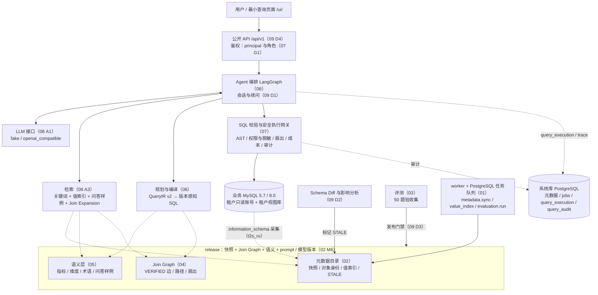
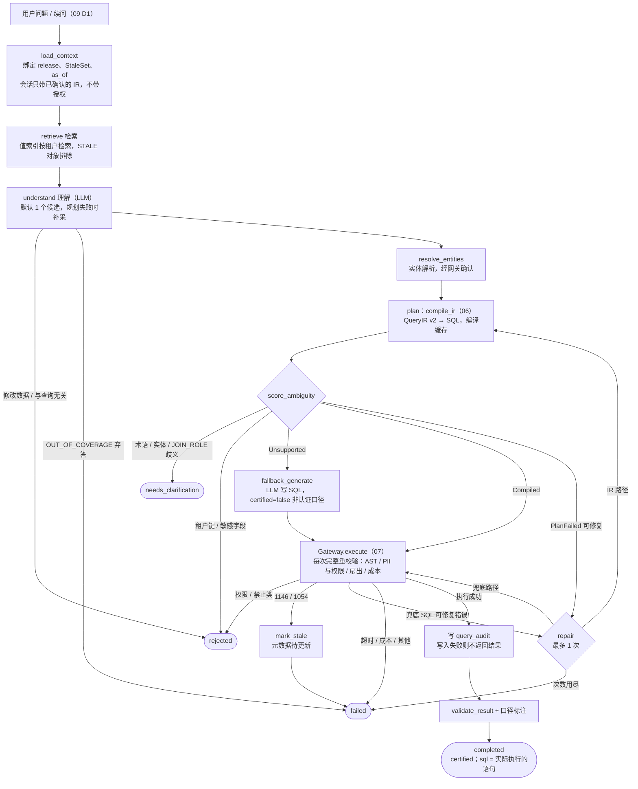
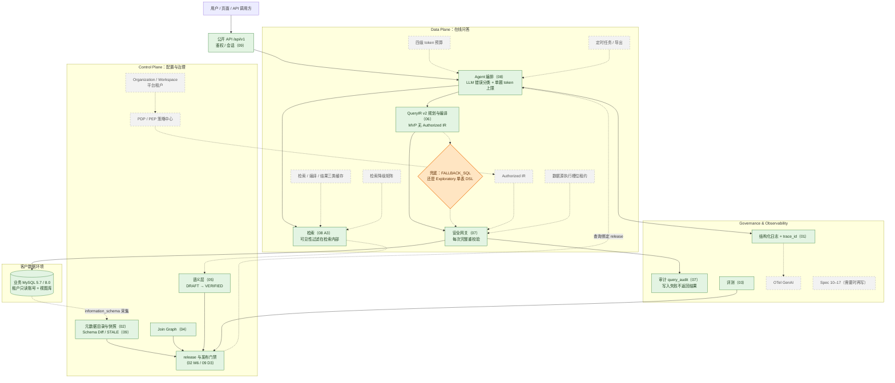

# SQLClaw

一个面向生产环境的 Text2SQL Agent：用户用自然语言提问，系统理解业务语义、规划查询、生成并校验 SQL，在受控环境中安全执行，并返回可追溯的结果。

> **当前状态（2026-11-24）：实现阶段，第 1 周。** 设计文档为 `docs/architecture.md` 与 `docs/specs/00～09`；Spec 01（工程基础：配置、日志与 `trace_id`、API 骨架、系统库与业务库连接、PostgreSQL 任务队列与 worker、Compose）已实现；Spec 02（元数据目录）按 `docs/plans/02-metadata.md` 进行中，Task 1～5（spec 修订、配置与错误码、注释注入检测、快照领域模型与内容哈希、MySQL 采集器）已完成，下一步是 Task 6（在 MySQL 5.7 / 8.0 上建夹具库做采集集成测试）。仓库 2026-11-23 由 `text2sql` 更名为 SQLClaw，Python 包名 `text2sql` 与环境变量前缀 `T2S_` 保持不变。

## 核心思路

不让 LLM 直接"猜" SQL，而是由元数据和语义层驱动：

- **Metadata Infrastructure**：采集表、字段、索引、主键/唯一键/外键，以不可变快照 + 发布指针管理版本。
- **Schema Evolution**：检测 Schema 变化，标记受影响的语义和 Join 关系，原子发布、可回滚。
- **Join Intelligence**：Join Graph + 基数分析，自动发现关联路径并检测扇出（多对一关系需要 PK/UK 佐证或人工确认）。
- **Semantic Layer**：指标、维度、业务术语统一定义（YAML + PR 审核），不允许 LLM 临时发明口径。
- **Query Planner**：LLM 先产出结构化的 Query IR，再由编译器生成 SQL；IR 覆盖不了的问题暂走"LLM 直写 SQL + 强校验"的兜底通道，结果标"非认证口径"并统计 `fallback_ratio`（是否改为 Exploratory 单表 DSL 是待定决策，见 Spec 08 顶部）。
- **SQL Validation**：基于 SQLGlot 的 AST 校验，加上语义、权限、成本校验；按 MySQL 5.7 / 8.0 版本区分方言能力。
- **Secure Execution Gateway**：只读副本 + 租户视图/账号作为第一道防线，AST 改写作为第二道防线；禁止 `EXPLAIN ANALYZE`，字段脱敏，全量审计，配套绕过测试集。
- **Evaluation**：从第 1 周起建设 50 题验收集，按执行结果比对评测，自动回归。

## 架构图

模块按 `docs/specs/01～09` 划分，括号里是 Spec 编号与小节；详细设计见 [架构方案](docs/architecture.md)，跨 Spec 的不变量见 [Spec 00](docs/specs/00-contracts.md)。



## Q2A 流程（一次提问到答案）

对应 [Spec 08 §4.12](docs/specs/08-agent.md) 的工作流，终态只有 `completed` / `needs_clarification` / `rejected` / `failed` 四种（执行中为 `running`）；`FALLBACK_SQL` 兜底通道的去留是待定决策，见 Spec 08 顶部。图中未画出的 LLM 失败、超预算、总时限超时也都进入 `failed`（[Spec 00 §5](docs/specs/00-contracts.md)）。



## 目标架构（演进路线）

基于 Architecture Baseline v1.0.3 §2.1 的四区划分（Control Plane / Data Plane / 客户数据环境 / Governance & Observability），按我们的审阅结论修正：可见性过滤在检索内部、MVP 没有 Authorized IR、API 保持 `/api/v1`、审计写入失败不返回结果。图例：🟩 绿色实线 = MVP 已有或已在 Spec 01～09 中规定；⬜ 灰色虚线 = 只定契约、后续实现（见 [Spec 00 §7](docs/specs/00-contracts.md)）；🟧 橙色 = 待定决策（见 Spec 08 顶部）。逐条采纳理由见 [Baseline 审阅与采纳](docs/research/03-architecture-baseline-review.md)，v1.0.3 原文见 [Baseline v1.0.3 原文存档](docs/research/04-architecture-baseline-v1.0.3.md)。



## 技术栈

| 层 | 选型 |
| --- | --- |
| Agent 编排 | LangGraph |
| API | FastAPI |
| SQL 解析与校验 | SQLGlot |
| 系统元数据 / 向量 / 任务队列 | PostgreSQL + pgvector |
| 业务数据库（MVP） | MySQL（只读副本） |

## 路线图

**6 周 MVP（1～2 名开发）**

| 周 | 主线 | 交付 |
| --- | --- | --- |
| 1 | 工程骨架、MySQL 元数据采集、Schema 快照、`trace_id` 日志 | 元数据快照可查询；目标库画像与分工表填完 |
| 2 | Join Graph、候选边生成与人工确认、Join Path Finder + 扇出检测 | 验收题都能给出 Join 路径 |
| 3 | 语义层、Query IR v2、版本感知的 SQL Compiler | IR → SQL 端到端可用，评测出第一版分数 |
| 4 | Validator、Execution Gateway、绕过测试集进 CI | 安全执行链路可用 |
| 5 | LangGraph 全链路、澄清策略、兜底通道 | 50 题全链路评测 |
| 6 | 基础多轮对话、手动 Schema Diff、发布与回滚、最小 API 和页面 | MVP 验收 |

MVP 之后分三个阶段：稳定与扩展（第 7～10 周）、规模化（第 11～16 周）、平台化（第 16 周以后）。详见架构文档第二十三章。

## 本地开发

需要 Python 3.12 和 [uv](https://docs.astral.sh/uv/)。

```bash
uv sync                # 创建 .venv 并安装依赖
uv run pytest          # 运行测试
uv run ruff check .    # 代码检查
uv run mypy            # 类型检查
```

## 文档

- [架构方案（修订版）](docs/architecture.md)：当前以此为准，含审阅修订说明。
- [Spec](docs/specs/)：`00-contracts`（跨 Spec 契约）与 `01-foundation` ～ `09-delivery`，每个子项目一份，带验收标准与修订记录。
- [实现计划](docs/plans/)：`01-foundation`（已完成）、`02-metadata`（进行中）。
- [学习笔记](docs/learning/README.md)：实现中难点的讲解。
- [原始方案](docs/spec-original.md)：修订前的原文，保留作对照。
- [调研笔记](docs/research/README.md)：业界实现与论文调研（如[多表 / 大 Schema 场景的 Text2SQL 前沿](docs/research/01-text2sql-sota.md)、[Architecture Baseline 审阅与采纳](docs/research/03-architecture-baseline-review.md)）和难题笔记，仅供参考，以架构方案和 spec 为准。
- [AGENTS.md](AGENTS.md)：给 AI 编码助手的项目约定（`CLAUDE.md` 引用同一份）。

## 目录结构（当前）

```
apps/api/            # API 入口（apps.api.main:app）
apps/worker/         # worker 入口
src/text2sql/        # common（配置、日志、追踪、错误码）、api、db、jobs（队列与 worker）、
                     # agent（LangGraph 挂载点，Spec 08 前为 echo 空图）、metadata（快照模型、MySQL 采集器）、security（prompt_guard）
migrations/          # Alembic 迁移
deployment/          # Docker Compose：PostgreSQL 16、MySQL 5.7、MySQL 8.0
tests/               # unit、integration
docs/                # architecture、specs、plans、research、learning
```

后续 Spec 会按架构文档第十八章加入 graph、semantic、planner、sql、execution、evaluation、benchmarks、prompts 等目录。

## 本地开发

> 下面所有账号密码只用于本机 Docker Compose，**不得用于任何其他环境**。

1. 准备配置：`cp .env.example .env`
2. 启动数据库（PostgreSQL 16、MySQL 5.7、MySQL 8.0）：
   ```bash
   docker compose -f deployment/compose.yaml up -d
   docker compose -f deployment/compose.yaml ps   # 三个服务都应为 (healthy)
   ```
   PostgreSQL 映射到宿主机 **5433**（容器内仍为 5432），MySQL 5.7 为 3307，MySQL 8.0 为 3308。
   Apple Silicon 上 MySQL 5.7 以 amd64 模拟运行，首次启动较慢；日常开发可只起 `pg mysql80`。
   应用服务（`api`、`worker`）将由 Spec 09 放在 profile `app` 中，本期只起数据库。
3. 运行迁移：`uv run alembic upgrade head`（回滚：`uv run alembic downgrade base`）
4. 启动 API：`uv run uvicorn apps.api.main:app --no-access-log`，检查 `curl -i localhost:8000/healthz` 与 `curl -i localhost:8000/readyz`
5. 启动 worker：`uv run python -m text2sql.jobs.worker`（Ctrl-C 处理完当前任务后退出）
6. 测试：
   ```bash
   uv run pytest                                          # 单元测试（不需要数据库）
   set -a && source .env && set +a && uv run pytest -m integration   # 集成测试（需要 Compose）
   ```
   集成测试读取 `T2S_TEST_SYSTEM_DB_URL`、`T2S_TEST_MYSQL57_URL`、`T2S_TEST_MYSQL80_URL`，未设置时自动跳过。
