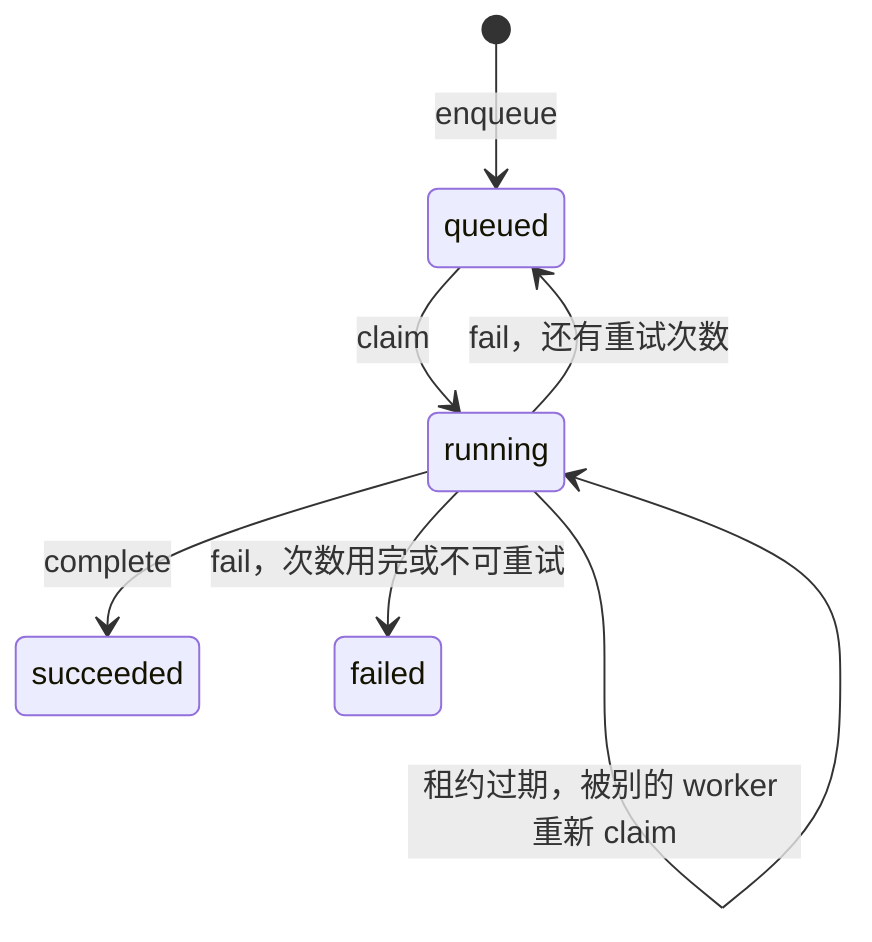

# 01 基于 PostgreSQL 的任务队列

对应代码：`src/text2sql/jobs/queue.py`，表结构见 `src/text2sql/db/models/jobs.py`（Plan 01 Task 5、Task 8）。

## 要解决什么问题

API 不能在一次 HTTP 请求里做很慢的活（比如 Agent 推理、采集业务库表结构），所以把活写进 `jobs` 表，由后台 worker 进程去执行。队列要保证：

1. 每个任务只被一个 worker 执行，多个 worker 并发也不会重复领取；
2. 失败了能自动重试，而且不会疯狂重试；
3. worker 中途崩溃，任务不会永远卡住。

我们没有引入 Kafka、RabbitMQ 或 Redis，而是直接用系统库 PostgreSQL 的一张表来做队列。少一个组件，部署和运维都更简单，对我们的任务量完全够用。

## `jobs` 表的关键列

| 列 | 含义 |
| --- | --- |
| `kind` | 任务类型，比如 `echo`，worker 根据它找对应的处理函数 |
| `payload` | 任务参数，JSONB |
| `status` | `queued` / `running` / `succeeded` / `failed`，由 CHECK 约束限制取值 |
| `attempts` / `max_attempts` | 已经尝试几次 / 最多尝试几次 |
| `run_after` | 最早什么时候可以执行，用来实现延迟重试 |
| `locked_until` | 租约到期时间：被 worker 领走后，锁到这个时间 |
| `last_error` | 最近一次的错误信息，最多 2000 字符 |
| `trace_id` | 入队时请求的追踪号，可以从 API 日志一路追到 worker 日志 |

`(status, run_after)` 上有联合索引，让"找出现在能跑的任务"这个查询更快。

## 任务的状态流转



## `enqueue`：入队

```python
def enqueue(session, kind, payload, *, max_attempts=3, run_after=None) -> int:
```

- 参数列表里的 `*` 表示后面的参数必须写名字传，比如 `max_attempts=5`，不能按位置传，防止传错。
- 先校验参数：`kind` 必须是 1 到 64 个字符，`max_attempts` 至少为 1。
- `trace_id=get_trace_id()` 记下当前请求的追踪号。
- `session.add(job)` 只是把对象交给会话，还没写库；`session.flush()` 才把 INSERT 发给数据库，这时数据库生成的 `id` 会回填到 `job.id`。注意 flush 不等于 commit，事务还没提交。

## `claim`：领任务（核心）

生成的 SQL 大致是：

```sql
UPDATE jobs SET status = 'running',
                attempts = attempts + 1,
                locked_until = now() + 租约秒数
WHERE id = (
    SELECT candidate.id FROM jobs AS candidate
    WHERE candidate.kind IN (...)
      AND ( (status = 'queued'  AND run_after <= now())       -- 到点的新任务
         OR (status = 'running' AND locked_until < now()) )   -- 租约过期的任务
    ORDER BY run_after, id
    LIMIT 1
    FOR UPDATE SKIP LOCKED
)
RETURNING *;
```

逐句拆开：

- **子查询负责挑任务**。能领的有两种：到点的 `queued` 任务，以及 `locked_until` 已过期的 `running` 任务（之前领它的 worker 多半已经挂了）。`ORDER BY run_after, id` 保证先到点的先执行。
- **`FOR UPDATE`**：给选中的行加行锁，当前事务结束前，别的事务改不了这一行。
- **`SKIP LOCKED`**：碰到被别人锁住的行就直接跳过，拿下一行，不排队等。比如 worker A 锁着 1 号，worker B 同时来领，就会直接拿到 2 号。没有这一句，B 会卡住等 A 释放锁，并发度就上不去。这是用 PostgreSQL 做队列的标准写法。
- **外层 `UPDATE ... RETURNING`**：挑任务和标记 `running` 在同一条语句里完成，中间没有空档，不会出现两个 worker 同时看中同一行的情况。`RETURNING` 把改完的整行直接返回给 Python，省掉一次查询。
- **租约（lease）**：`locked_until` 就是 worker 对任务的"租期"。正常执行完，worker 会调 `complete` 或 `fail` 清掉它；worker 崩溃时没人清，过期后别的 worker 可以重新领。代价是同一个任务在极端情况下可能被执行两次，所以任务处理函数最好写成幂等的：执行一次和执行两次效果一样。
- **`aliased(Job, name="candidate")`**：给子查询里的表起别名。如果不起，SQLAlchemy 会把子查询里的 `jobs` 和外层 `UPDATE jobs` 当成同一张表自动关联（auto-correlate），生成的 SQL 就不对了。
- 返回 `Job | None`：没有可领的任务就返回 `None`，worker 会歇一会儿再来。`kinds` 为空也直接返回 `None`。

## `complete`：标记成功

把 `status` 改成 `succeeded`，清空 `locked_until`。用 `RETURNING Job.id` 判断是否真的更新到了行：没有返回值，说明 id 不存在，抛出 `JobNotFoundError`。

## `fail`：标记失败与重试

1. 先用 `SELECT ... FOR UPDATE` 读出 `attempts` 和 `max_attempts`，同时把这一行锁住，防止并发修改。
2. 如果 `retryable` 为真，并且 `attempts < max_attempts`：
   - 状态退回 `queued`；
   - `run_after = now() + 2 ** attempts` 秒，第 1 次失败后等 2 秒，第 2 次等 4 秒，第 3 次等 8 秒。这就是**指数退避**：下游如果正在故障，越往后重试间隔越长，不会把它打得更惨。
3. 否则直接标成 `failed`，不再执行。
4. 错误信息用 `truncate_error` 截断到 2000 字符，防止超长堆栈把表撑大。

代码里的 `values: dict[str, Any] = {...}` 先把要更新的字段攒进字典，再用 `.values(**values)` 一次传进去。`**` 是 Python 把字典展开成关键字参数的语法。

## 两个异常

- `NonRetryableJobError`：任务处理函数主动抛出它，表示"重试也没用"，比如 payload 本身格式就错了。worker 遇到它会调用 `fail(..., retryable=False)`，直接判为失败。
- `JobNotFoundError(LookupError)`：任务 id 不存在。它继承 Python 内置的 `LookupError`，和 `KeyError`、`IndexError` 是同一类"查找失败"异常。

## 为什么这些函数都不 commit

文件开头写着 "Callers own the transaction"：事务由调用方负责。好处是调用方可以把几件事放进同一个事务，比如"创建一条业务记录"和"为它入队一个任务"，要么一起成功，要么一起回滚。

## 一个容易踩的坑：`now()` 是事务开始的时间

PostgreSQL 的 `now()` 返回的是**当前事务开始时**的时间，不是当前这条语句执行的时间。如果一个事务开了很久，里面的 `claim` 看到的"现在"就是旧的。所以每次 `claim` 都必须放在一个新的短事务里，Task 9 的 worker 就是这么做的。

## 测试怎么验证这些行为

`tests/integration/test_queue.py` 连真实 PostgreSQL 运行：

```
set -a && source .env.example && set +a && uv run pytest -m integration tests/integration/test_queue.py -v
```

覆盖的行为：

- 入队时记录 trace_id；
- 领取后状态变为 `running`，租约设置正确；
- 按 `kind` 过滤，未到 `run_after` 的任务不会被领；
- 按 `run_after`、id 的顺序领取；
- 两个会话同时 claim 拿到的是不同任务（验证 SKIP LOCKED）；
- 租约过期的任务可以被重新领取，`attempts` 变为 2；
- 失败后按退避时间重试，次数用完变成 `failed`；
- 不可重试的错误直接失败，错误信息被截断到 2000 字符；
- 不存在的 id 抛出 `JobNotFoundError`。

参数校验这类不需要数据库的规则，放在 `tests/unit/test_queue_rules.py`。

## 推荐阅读顺序

先看 `enqueue`，再看 `claim`（对照上面的 SQL），最后看 `fail`。读完可以自己进库观察：

```
docker compose -f deployment/compose.yaml exec pg psql -U t2s -d t2s_system
```

```sql
SELECT id, kind, status, attempts, run_after, locked_until FROM jobs ORDER BY id;
```
