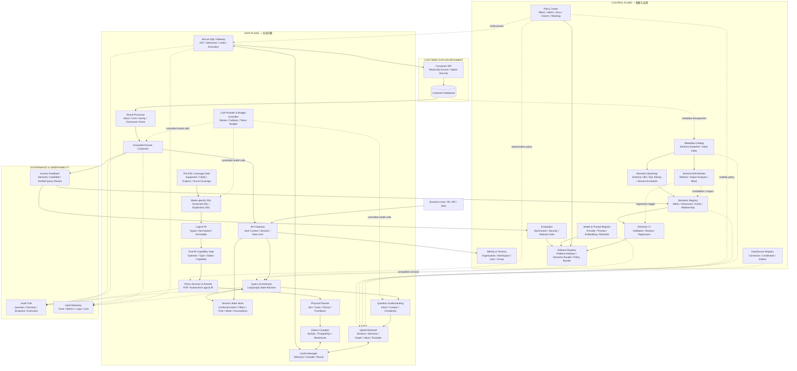
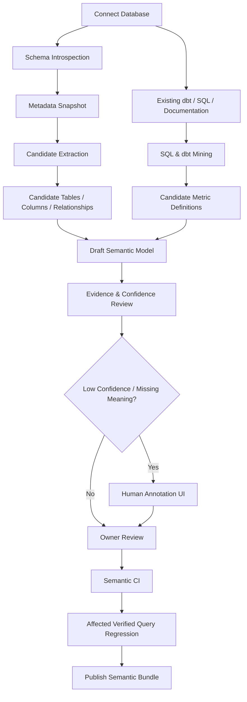
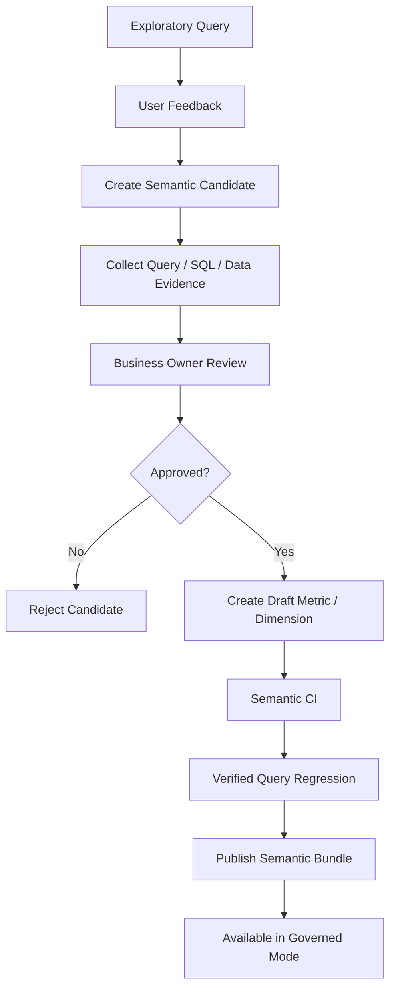
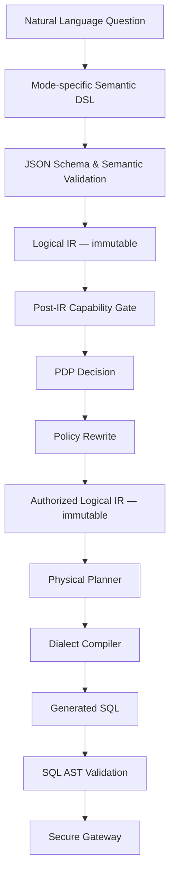
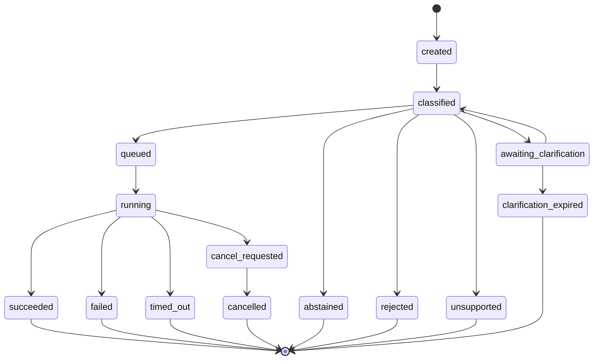
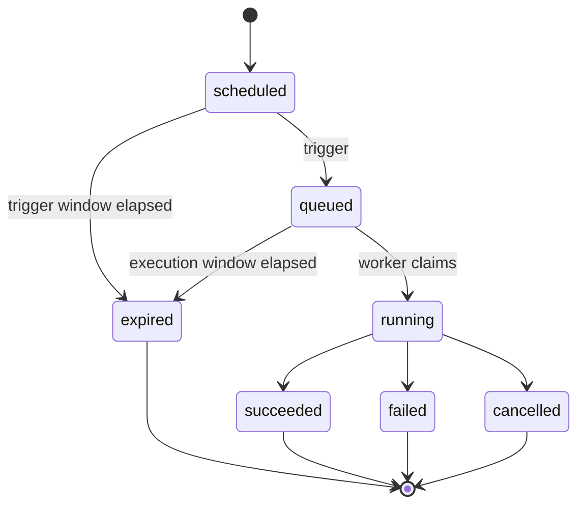
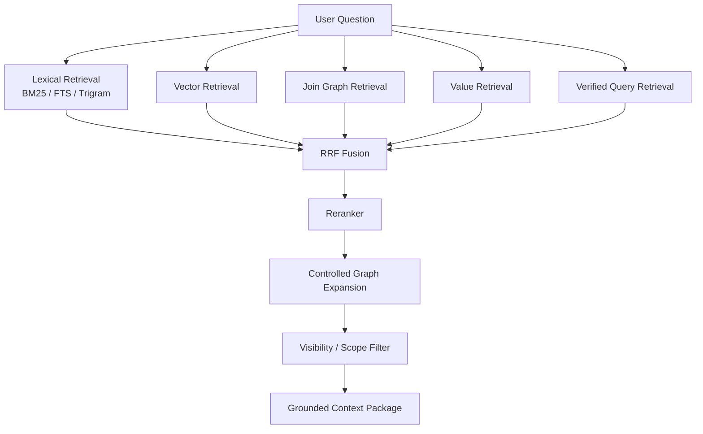
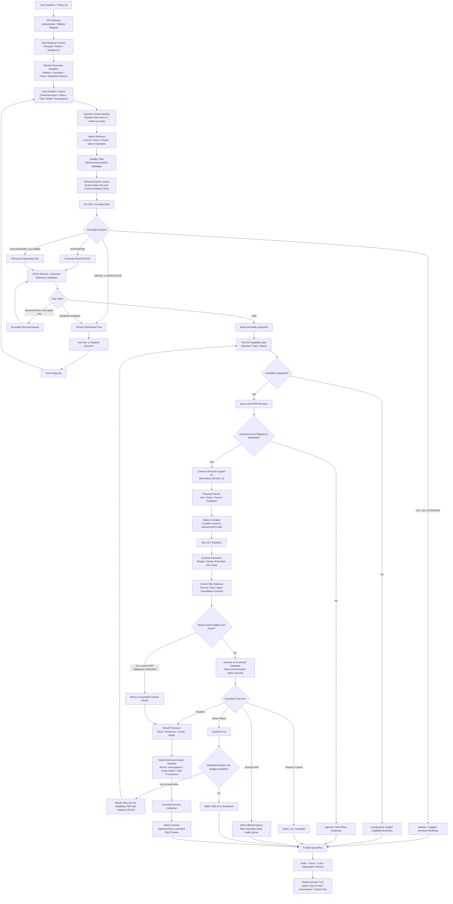
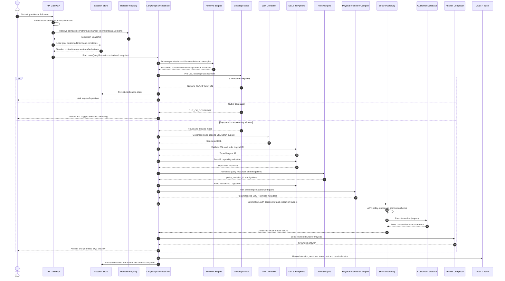
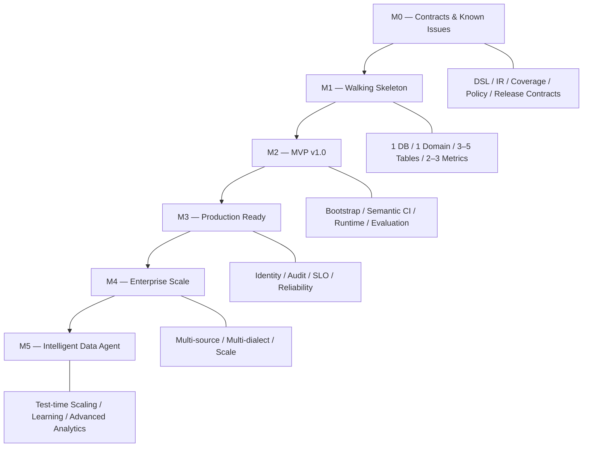

# SQLClaw Architecture Baseline v1.0.3（原文存档）

> **状态**：目标架构参考（非现行规格）
> **现行规格**：以 [docs/architecture.md](../architecture.md) + [docs/specs/00–09](../specs/) 为准；本文与现行规格冲突时，以现行规格为准。
> **采纳结论**：见 [03-architecture-baseline-review.md](03-architecture-baseline-review.md)。
> **存档说明**：2026-11-24 存档。下方「原文」为用户提供的 v1.0.3 全文（原文件名 `SQLClaw_Architecture_Baseline_v1.0.3.md`），措辞未改；仅将原文各级标题整体降一级，使本文只有一个 H1。

## 章节对照表

| v1.0.3 章节 | 对应现行规格 | 状态 | 说明 |
|---|---|---|---|
| §0 执行摘要（七项决策 / 三条底线 / 双模式 / M0 横切契约） | 00-contracts §1；architecture.md 修订说明 10 | 已采纳（部分） | 底线 1「LLM 不得绕过 DSL 执行 SQL」与现行 FALLBACK_SQL 冲突 → **待定**（architecture.md §9.4；08 顶部待定决策） |
| §1 设计依据与方法论 | research/01；03 参考核验 | 仅参考 | 参考文献已核验存在 |
| §2 系统总体架构 | README「目标架构（演进路线）」图；architecture.md | 已采纳（部分） | 模块化单体 + 独立 Worker 与现状一致；Control Plane 多数模块只定契约 |
| §3 Semantic Layer（含 3.8 Schema Drift） | 05-semantic；02 M7；09 D2；00 I4/I5、§3 | 已采纳（Drift 阻断语义、错误码映射） | Bootstrap 人工审核 / 晋升流程放到阶段 2；生命周期按 05 现行状态 |
| §4 两种 DSL 契约 | 06-ir-compiler（QueryIR v2）；00 §4 | 已采纳（COUNT(*) `all_rows`、typed ref） / **待定**（Exploratory DSL） | Exploratory 单表 DSL 与 FALLBACK_SQL 的取舍按 fallback_ratio 定（06 §7、08 顶部） |
| §5 Coverage Gate / Clarification / Session | 08 §4.5、§4.7、§4.12；09 D1 | 已采纳 | 现行 08 保留两处歧义入口（理解阶段 + 规划阶段），不只在 Pre-DSL |
| §6 Logical IR / Authorized IR / Physical Plan / Compiler | 06；00 §2.3 | 只定契约 | QueryIR v2 ≈ Governed DSL，Planner 逻辑计划 ≈ Physical Plan；MVP 无 Authorized IR |
| §7 Identity / Policy / Secure Gateway | 07-gateway；00 §1 | 已采纳（PII 单表规则） / 只定契约（PDP/PEP、Organization/Workspace） | MVP 隔离靠租户视图/只读账号 + Gateway |
| §8 Query Runtime（生命周期、硬限制、取消、Job Queue、LLM 故障、预算、异步/定时） | 00 §2.1–2.2、§5；01 §4.6（renew_lease）；07 §4.8；08 §4.2 | 已采纳（renew_lease、LLM 错误分类、429/deadline、硬限制） | PG 执行槽位租约、全链路取消、Org/Workspace 预算账本、定时任务/导出只定契约 |
| §9 Retrieval Engine（9.1 缓存、9.2 降级、9.3 Q2A） | 08 A3；00 §6；README「Q2A 流程」 | 9.1/9.2 只定契约；9.3 作为契约采纳（顺序问题见下） | MVP 不做 Result Cache；QueryRun 追踪字段见 00 §6 |
| §10 Answer Composer 与对外结果（含 10.5 API 版本） | 08 §4.14；09 D4 | 已采纳（`certified`、`sql` = 实际执行 SQL、API 与 DSL/IR 版本分离） | `/v1` 路径不采纳（保持 `/api/v1`）；弃用策略只定契约 |
| §11 Evaluation | 03-eval（E11 Oracle、abstain 指标、out_of_coverage 类别） | 已采纳（Coverage/Abstention/Oracle） | 「20 轮 Walking Skeleton」不采纳，沿用 03 的 50 题集 |
| §12 Versioning 与 Release Model | 02 M6；00 §2.3 | 只定契约 | Platform/Semantic/Policy Bundle、Execution Snapshot 后置 |
| §13 Audit / Privacy / Observability | 07 §4.11；08 §4.13；00 §6 | 维持现行（审计 fail-closed 为强制） | OTel GenAI 全链路只定契约 |
| §14 建议技术选型 | architecture.md 第 3、24 章 | 一致 | — |
| §15 Spec 文档结构与优先级 | docs/specs 00–09 | 不采纳 | 不拆 10–17 号 Spec；相关内容并入 00–09 |
| §16 已知问题与必须修复项 | 03 §3 逐条核对 | 不采纳（多数与现行规格不符） | 真实问题已分别修入 01/03/07/08 |
| §17 研发路线（M0–M5） | architecture.md 第 23 章；docs/plans | 不采纳 | 以 docs/plans 顺序为准 |
| §18 MVP 验收标准 | 各 Spec 验收清单；03 E8；09 D7 | 部分采纳 | TTFCA / Bootstrap Precision 不进 MVP 验收 |
| §19 最终架构决策记录 | architecture.md 第 24 章 | 部分采纳 | — |
| §20 参考资料 + 最终结论 | 03 参考核验 | 仅参考 | — |

## 原文已知问题（阅读时注意）

1. **§9.3.1 Q2A 主执行图顺序**：
   - Retrieval Cache Lookup 画在 Hybrid Retrieval 之后，查缓存应在检索之前。
   - Result Cache 判断画在 Secure Gateway 之后，应在 PDP/编译之后、Runtime Admission（占槽位）之前。
   - Audit 画在返回答案之后，与审计 fail-closed（现行 07）冲突。
   - Planner/Join 阶段发现的歧义没有回到 Clarification。
   - 缺少 `budget_exceeded`、LLM 调用失败、`clarification_expired` 等出口；Schema Drift 出口在 §8.1 生命周期里没有对应状态。
2. **§16 已知问题表**：多数条目与现行 specs 不符（逐条核对见 03 §3）。
3. **§15 Spec 目录**：规划 00–17 共 18 份 Spec，与现行 00–09 + architecture.md 的组织方式冲突。
4. **§8.1 生命周期**：`budget_exceeded` 未进入 QueryRun 状态图，但 §8.6、§13.1 把它当终态；§13.1 的 `expired` 属于 ScheduleOccurrence 而非 QueryRun，命名混用。
5. **§8.2 执行槽位租约**：过期租约由回收任务重新分配，但未要求 fencing token / attempt 校验，长查询续租失败时可能超配；现行 01 用 `attempts` 作 claim token。
6. **§4.2 DSL 引用**：`order_by` 用 `"field": "row_count"`（引用别名），其余位置用 `field_id`，引用类型不统一；现行 00 §4 改为 typed ref。
7. **§8.5 重试与 deadline**：`provider_timeout` 允许一次重试，但未要求重试前确认剩余 deadline 足够一次完整调用（现行 08 已规定）。
8. **§13.1 审计失败**：原文只「建议 fail-closed」；现行 07 为强制。
9. **§18.1 TTFCA**：「Correct」依赖业务 Owner 人工确认，无法自动测量，不宜作为验收指标。

---

## 原文

## SQLClaw Architecture Baseline v1.0.3

> **状态**：Architecture Baseline / Proposed Freeze  
> **版本**：v1.0.3  
> **日期**：2026-11-24
> **本次修订**：在 v1.0.2 基础上新增 Question-to-Answer（Q2A）完整端到端执行契约、组件交互时序、多轮追问规则和统一可观测性字段。  
> **适用范围**：SQLClaw 核心架构、MVP、后续企业级演进  
> **文档定位**：本文件定义架构原则、模块边界、跨模块契约和研发顺序；具体字段、API、状态机和测试用例由对应 Spec 进一步细化。
>
> **修订记录**：v1.0.3 在 v1.0.2 基础上新增 Q2A 主执行图、组件交互时序图、多轮追问标准处理和 QueryRun 统一追踪要求；未改变 v1.0.2 已冻结的模块边界与安全原则。

---

### 0. 执行摘要

SQLClaw 定位为 **Governed Semantic Query Engine**：面向企业数据分析的语义驱动型智能查询引擎。

核心技术范式：

**Semantic-first + Agent-orchestrated + DSL-driven + IR-based + Compiler-executed + Policy-enforced + Evaluation-driven。**

SQLClaw 不以“尽可能生成 SQL”为目标，而以“准确判断哪些问题可以回答，并且只在语义正确、权限允许、执行安全的前提下给出可信答案”为目标。

#### 0.1 七项架构决策

1. **Semantic-first**：以业务语义对象为查询入口，不让模型直接猜测物理表和业务口径。
2. **受控 Agent Orchestration**：使用显式状态图编排查询流程，不采用无约束 Multi-Agent Swarm。
3. **DSL 而非 SQL**：LLM 输出结构化 Semantic DSL，不直接输出可执行 SQL。
4. **Logical IR 与 Physical Plan 分离**：用户查询逻辑与物理执行优化分别建模。
5. **确定性 SQL 生成**：由 Planner 和 Dialect Compiler 生成 SQL。
6. **Policy 在模型之外执行**：统一 PDP/PEP、Secure Gateway 和数据库原生权限形成纵深防御。
7. **Coverage 与 Evaluation 一等公民**：系统必须知道何时回答、澄清、探索、弃答或拒绝。

#### 0.2 三条不可突破的底线

- LLM 不得绕过 DSL、IR、Policy 和 Secure Gateway 直接执行 SQL。
- 权限判断必须由确定性 Policy Engine 执行，不得依赖 Prompt 或模型自我约束。
- 不默认使用多候选、多 Agent 和多轮自动修复；根据查询难度、质量信号和预算动态启用。

#### 0.3 两种查询模式

| 模式 | 定位 | 查询对象 | 适用场景 |
|---|---|---|---|
| **Governed Mode** | 受治理、权威口径 | 已审核发布的 Metric、Dimension、Entity、Relationship | 正式经营分析、财务报表、跨部门指标 |
| **Exploratory Mode** | 受限探索、非认证口径 | 已授权的物理 Catalog Table/Column | 临时探索、原始数据分析、语义模型尚未覆盖的问题 |

两种模式共享权限系统、Logical IR、Physical Plan、Compiler、Gateway 和审计系统。Exploratory Mode 不是安全降级模式；它有独立 DSL、白名单算子、更严格的资源限制和结果标识。

#### 0.4 M0 必须冻结的横切契约

除 DSL、IR、Policy 和 Release 外，M0 还必须冻结以下行为契约；冻结契约不代表所有能力都要在 M0 完整实现：

1. **多轮 Session**：保存已确认查询意图、DSL/IR 引用、时间边界、过滤条件、模式、假设和版本引用；每轮追问生成完整新 DSL，并重新经过 Coverage、Capability、PDP 和执行链。
2. **缓存隔离**：检索、编译、结果缓存分别定义键、准入条件、失效和权限边界；结果缓存不满足数据新鲜度证明时默认关闭。
3. **LLM 故障边界**：区分传输失败、限流、结构化输出错误、Schema 错误和语义歧义；重试、修复和 Provider Fallback 都受总预算约束。
4. **Token/成本预算**：按 Organization、Workspace、Query 和编排步骤记录，并将重试、降级和 Fallback 计入同一预算。
5. **Schema Drift**：定义刷新、影响分析、查询阻断和重新授权规则；不得自动改用同名字段继续回答。
6. **异步/定时任务**：预留独立生命周期；每次触发和执行前重新授权。
7. **外部 API 版本**：API 版本与内部 DSL/IR 版本分离，M0 冻结兼容和弃用规则。
8. **检索降级**：明确各召回通道的可降级性；权限可见性、PDP 和 Gateway 始终 Fail Closed。

---

### 1. 设计依据与方法论

企业级 Text-to-SQL 面临的关键挑战不止是 SQL 语法生成，还包括 Schema 检索、Join Key 识别、业务知识 grounding、查询拆解、权限、安全执行、歧义澄清和结果可信度。

值得借鉴的研究与工业实践：

| 方向 | 代表工作 | 对 SQLClaw 的启示 |
|---|---|---|
| 真实企业工作流 | Spider 2.0 | 复杂数据环境需要元数据检索、多方言和多步骤工作流支持 |
| 企业数据集与细粒度评测 | BEAVER | 将表检索、Join Key、列映射、领域知识和查询拆解分别评估 |
| 企业私有知识 grounding | EntSQL | 企业指标、报表约定和内部知识不能只靠数据库 Schema 推断 |
| 多候选生成与选择 | XiYan-SQL | 候选生成和重排可用于困难查询，但应受预算约束 |
| 测试时计算扩展 | Agentar-Scale-SQL | 对 Hard 查询使用迭代、并行候选和选择策略，不应默认应用于所有请求 |
| 歧义状态外置 | PlanPool | 发现歧义不等于解决歧义，需要持久化澄清计划和状态 |
| 语义层 | Snowflake Semantic Views、dbt Semantic Layer | Metric、Dimension、Entity、Relationship 应成为可治理的查询契约 |
| 企业检索 | NIFT-SQL（预印本） | 客户专属查询反馈可能改善表检索，但需要真实客户标注和离线验证 |

**方法论约束**：公开 Benchmark 的 SOTA 数字不能直接作为 SQLClaw 的生产准确率预期。论文的计算预算、数据集、标注提示、候选数量和执行环境可能与 SQLClaw 的生产限制不同。所有技术引入都必须通过 SQLClaw 自己的业务集、消融实验、成本与延迟评估。

参考资料见文末“参考资料”。

---

### 2. 系统总体架构

系统划分为四个逻辑区域：

1. **Control Plane**：身份、数据源、元数据、语义模型、策略、模型和发布管理。
2. **Data Plane**：在线理解问题、检索、覆盖判断、DSL/IR 生成、规划、编译和执行。
3. **Customer Data Environment**：客户数据库与数据连接器。
4. **Governance & Observability**：评测、审计、Trace、Metrics、反馈和回归。

#### 2.1 总体架构图



#### 2.2 Control Plane

| 模块 | 职责 | MVP 范围 |
|---|---|---|
| Identity & Tenancy | Organization、Workspace、User、Group、Service Account | 保留数据模型和请求上下文；先不做完整 SSO |
| DataSource Registry | 数据源注册、连接生命周期、凭据和方言 | 单数据源起步，保留 Connector 接口 |
| Metadata Catalog | Schema Snapshot、对象 ID、索引和值索引 | 必须实现 |
| Semantic Bootstrap | 从 Schema、dbt、SQL 和人工标注生成候选模型 | 基础版必须实现 |
| Semantic Registry | 管理业务模型及版本 | 必须实现 |
| Semantic CI | 语义校验、审核和回归 | 基础版必须实现 |
| Policy Center | 统一策略和策略版本 | 基础版必须实现 |
| Model & Prompt Registry | Provider、Model、Prompt、Embedding、Reranker | 先配置化和记录版本 |
| Release Registry | 平台、语义、策略和执行版本 | 基础版必须实现 |
| Evaluation | 离线评测、回归和安全门禁 | 必须实现基础集 |

#### 2.3 Data Plane

| 模块 | 职责 |
|---|---|
| API Gateway | 用户身份上下文、会话、请求限流 |
| Query Orchestrator | LangGraph 状态与流程编排 |
| Question Understanding | 意图、上下文、查询类型和复杂度识别 |
| Hybrid Retrieval | Schema、语义、关系、值和案例检索 |
| Pre-DSL Coverage Gate | 判断语义覆盖、澄清需求和探索路径 |
| Semantic DSL | 生成受 JSON Schema 约束的结构化查询 |
| Logical IR | 业务查询的规范化、不可变表示 |
| Post-IR Capability Gate | 判断算子、类型和 Dialect 是否支持 |
| Policy Decision & Rewrite | PDP 决策并生成 Authorized Logical IR |
| Physical Planner | Join、Grain、Fanout、下推和执行策略 |
| Dialect Compiler | 确定性生成目标方言 SQL |
| Secure SQL Gateway | AST 校验、执行准入、资源限制和审计 |
| Result Processor | 脱敏、披露风险检查、结果限制和校验 |
| Answer Composer | 基于受限结果生成最终回答 |

#### 2.4 部署形态

MVP 采用**模块化单体 + 独立 Worker**：

- API 服务承载同步请求、会话和轻量编排入口。
- Worker 处理评测、Metadata Refresh、长任务和允许异步执行的查询。
- SQL Gateway 在逻辑上独立，初期可以同进程模块部署，但必须有独立接口和安全边界。
- PostgreSQL 作为 Metadata、Semantic Registry、Policy、Job 和 Audit 的起步存储。

不在 MVP 阶段拆成大量微服务。模块需要清晰接口、独立测试和可演进边界。

---

### 3. Semantic Layer

Semantic Layer 是 SQLClaw 的业务核心，不是普通的 Schema 描述文件，也不是一个仅供 RAG 使用的文档集合。

#### 3.1 核心对象

| 对象 | 职责 | 示例 |
|---|---|---|
| Domain | 业务领域 | sales、customer、finance |
| Logical Table | 业务实体对应的逻辑表 | orders、customers |
| Entity | 业务实体及主键/自然键 | Order、Customer |
| Metric | 经过定义的业务指标 | net_revenue、order_count |
| Dimension | 分析维度 | region、paid_month、status |
| Relationship | 逻辑表之间的关系 | orders → customers |
| Enum | 业务枚举和值含义 | order_status |
| Term | 业务术语、同义词和缩写 | GMV、成交额 |
| Verified Query | 经过审核的问题、DSL/IR 与口径 | 月净销售额 |
| Policy Annotation | 敏感级别和可用位置限制 | PII、confidential |

#### 3.2 Metric 的必要定义

每个正式 Metric 至少应明确：

- 稳定 ID、名称、描述和 Owner。
- 计算表达式及类型。
- 聚合方式。
- Grain（统计粒度）。
- 时间维度与时区语义。
- 币种、单位和 Null 语义（适用时）。
- 允许使用的 Dimension 和 Filter。
- 依赖对象及其版本。
- 状态、审批人和证据来源。

示例：

```yaml
metric:
  id: net_revenue
  name: Net Revenue
  description: Paid amount minus refund amount at order grain
  grain: order
  expression:
    type: subtract
    left: paid_amount
    right: refund_amount
  aggregation: sum
  time_dimension: paid_at
  currency: CNY
  status: approved
  owner: sales-data-owner
```

Grain 是防止多表 Join 后重复计算的基础。没有 Grain、聚合语义和关系证据的复杂 Metric 不应直接发布。

#### 3.3 Semantic Bootstrap

用户连接数据库后，SQLClaw 必须能够从基础元数据开始工作，而不是要求用户先手写完整语义模型。

数据来源：

1. 数据库 Schema、字段类型、注释、索引和约束。
2. dbt Models、Tests、Descriptions、Lineage。
3. 已授权 SQL 脚本和查询日志。
4. 业务词汇表、指标文档和数据字典。
5. 人工标注和业务 Owner 确认。

**自动抽取只生成 Candidate，不自动生成权威业务口径。** SQL 中有人使用某种表达式，只能说明它曾经被使用，不能证明它是公司标准指标。



#### 3.4 人工辅助模式

生产数据库经常缺少外键，表名和字段名也可能是拼音、历史编号或内部缩写。因此 Bootstrap 必须列出无法可靠推断的对象，而不是强行猜测。

至少显示：

- 无法解释的表名和字段名。
- 缺少 Join 证据的表关系。
- 存在多种可能含义的字段。
- 缺少 Grain 的事实表。
- 无法确认口径的 SQL/Metric 候选。
- 需要业务 Owner 确认的默认时间维度、单位和币种。

每个 Candidate 保留：`candidate_id`、`object_id`、`definition`、`source_evidence`、`confidence`、`provenance`、`suggested_owner`、`review_status`、`reviewer`、`approved_version`。

#### 3.5 Semantic Lifecycle

状态：

`draft → review → approved → released → deprecated`

每个 Semantic Object 必须能够追踪 Owner、Reviewer、证据、版本和变更历史。

#### 3.6 Semantic CI

每次 Semantic Bundle 变更至少执行：

1. 引用对象存在性和类型检查。
2. Metric 表达式和依赖检查。
3. Grain 与聚合语义检查。
4. Relationship 基数和方向检查。
5. Fanout、Chasm Trap 和多路径歧义检查。
6. Schema Drift 影响分析。
7. 受影响 Verified Query 自动回归。
8. Owner 审批和发布兼容性检查。

#### 3.7 Exploratory → Governed 晋升

探索查询可以成为语义模型建设的候选来源，但不能直接沉淀为 Verified Query 或正式 Metric。



禁止 Exploratory 执行结果自动进入 Verified Query 通道。晋升必须经过 Draft、业务审核、Semantic CI 和正式发布。

#### 3.8 Schema Drift 契约

Schema Snapshot 是查询编译和语义映射的依据。系统必须定义周期刷新与按需刷新机制，并将 Schema Drift 视为可影响查询正确性的运行时事件，而不是单纯的后台元数据同步。

**刷新触发：**

- 周期性 Metadata Refresh，间隔由数据源规模和变更频率配置。
- 管理员手动触发 Refresh。
- 查询执行前发现 Snapshot 超过允许的新鲜度窗口。
- 数据库返回列不存在、类型不兼容、对象权限变化等疑似 Drift 错误。

**变更分类：**

| Drift 类型 | 示例 | 默认处理 |
|---|---|---|
| Additive | 新增非关键列、注释变化 | 生成新 Snapshot，评估后可继续旧范围查询 |
| Breaking | 删除列、类型不兼容、Join Key 改变 | 阻断所有受影响的 Metric/Query，通知 Owner |
| Semantic | 同名字段业务含义变化、枚举口径变化 | 标记语义过期，必须审核新定义 |
| Permission | 数据库权限、View/RLS 或授权范围变化 | 立即重新授权；无法确认时拒绝执行 |

**硬规则：**

1. 每个 Metadata Object 维护依赖索引，能从物理表列追踪到 Logical Table、Metric、Dimension、Relationship 和 Verified Query。
2. 删除列、类型不兼容、Join Key 变化等 Breaking Drift 必须阻断受影响的 Governed 查询；不得静默跳过该字段。
3. 执行时遇到疑似 Drift，当前查询失败并记录 `SCHEMA_DRIFT_DETECTED`；触发 Refresh 和 Impact Analysis。
4. 不得自动将失效字段替换为同名字段、相似字段或其他表中的“看起来等价”的字段。
5. Refresh 后必须重新执行 Coverage、DSL/IR 校验、PDP 和相关 Verified Query 回归；只有兼容性确认后才能重试。
6. Exploratory 查询也不得绕过当前 Catalog Snapshot 和 Policy；物理对象 ID 失效时必须停止。

M0 冻结错误码、阻断语义和依赖关系契约；M2 实现自动刷新、影响分析、Owner 通知和恢复工作流。

---

### 4. 两种 DSL 契约

DSL 是 LLM 与 SQLClaw 确定性执行链路之间的协议，必须在 M0 冻结 JSON Schema v1。

所有 DSL 必须：

- 指定 `dsl_version` 和 `mode`。
- 使用 Catalog/Semantic Registry 提供的稳定对象 ID。
- 通过 JSON Schema 验证。
- 禁止原始 SQL 字符串和任意函数表达式。
- 对 Filter Operator、函数和类型进行白名单校验。
- 对不支持字段和算子给出结构化错误。

#### 4.1 Governed DSL

Governed DSL 只能引用已发布 Semantic Bundle 中的语义对象。

```json
{
  "dsl_version": "v1",
  "mode": "governed",
  "domain_id": "sales",
  "metrics": [
    { "metric_id": "net_revenue" }
  ],
  "dimensions": [
    { "dimension_id": "region" },
    { "dimension_id": "paid_month" }
  ],
  "filters": [
    {
      "field_id": "order_status",
      "operator": "in",
      "values": ["paid"]
    }
  ],
  "time_range": {
    "dimension_id": "paid_at",
    "preset": "last_30_days"
  },
  "order_by": [
    { "field_id": "net_revenue", "direction": "desc" }
  ],
  "limit": 100
}
```

#### 4.2 Exploratory DSL v1

MVP 的 Exploratory DSL 采用严格子集：

- 单表查询。
- 字段投影。
- 基础 Filter。
- Group By。
- 固定聚合函数白名单。
- Sort 和 Limit。
- 参数化取值。

MVP **不允许未审核跨表 Join，不允许任意表达式，不允许自由 SQL 函数**。

```json
{
  "dsl_version": "v1",
  "mode": "exploratory",
  "source": {
    "table_id": "table_001"
  },
  "fields": [
    { "field_id": "column_001" }
  ],
  "filters": [
    {
      "field_id": "column_002",
      "operator": "eq",
      "value": "paid"
    }
  ],
  "group_by": ["column_001"],
  "aggregations": [
    {
      "function": "count",
      "operand": { "type": "all_rows" },
      "alias": "row_count"
    }
  ],
  "order_by": [
    { "field": "row_count", "direction": "desc" }
  ],
  "limit": 100
}
```

`table_id` 和 `field_id` 是 Metadata Catalog 中的稳定对象 ID，不允许模型直接填写任意物理表名和列名。

`COUNT(*)` 必须用显式操作数表达：`{"function":"count","operand":{"type":"all_rows"}}`；`COUNT(column)` 则使用 `{"type":"field","field_id":"..."}`。不得用 `field_id: null` 兼任“统计所有行”的含义。JSON Schema 中 `null` 是一个明确值，与属性缺失不同，因此不能混用。

#### 4.3 Exploratory 算子白名单

| 类型 | MVP 支持 | 约束 |
|---|---|---|
| Projection | 是 | 仅可授权字段 |
| Filter | 是 | 类型兼容的运算符白名单 |
| Group By | 是 | 不允许敏感字段默认分组 |
| COUNT | 是 | 遵循披露策略 |
| SUM / AVG / MIN / MAX | 是 | 受字段类型和敏感级别约束 |
| COUNT DISTINCT | 条件支持 | 必须经过独立 Policy 决策 |
| Join | 否 | 仅在 Relationship 审核后扩展 |
| 自由表达式 | 否 | 后续通过 Typed Expression AST 扩展 |
| 任意 SQL 函数 | 否 | 禁止 |
| CTE / Window Function | 否 | 后续阶段评估 |

#### 4.4 Exploratory 安全规则

1. 只能访问当前用户获授权的 Catalog 对象。
2. MVP 不允许未审核跨表 Join。
3. PII 字段不能默认投影、分组、过滤或聚合。
4. `COUNT(DISTINCT pii_column)` 必须由独立策略决定，不能因为是聚合就自动允许。
5. 小样本分组、差分查询和重复查询带来的推断风险需要披露控制。
6. Exploratory 使用比 Governed 更严格的行数、字节数、超时、并发和 Token 预算。
7. 结果必须携带 `mode=exploratory` 和非认证口径标识。
8. 导出、分享、API 和下游报表必须保留探索模式水印/元数据。
9. 结果不得自动进入 Verified Query 或正式 Metric。
10. 人工晋升必须经过语义审核与发布流程。

---

### 5. Coverage Gate 与 Clarification

Coverage 不是一个放在单个节点里的简单分类器，而是两个不同阶段的能力判断。

#### 5.1 Pre-DSL Coverage Gate

位置：`Retrieval → Pre-DSL Coverage → DSL`。

它只判断：

- 问题能否映射到已发布 Semantic Model。
- 是否存在会改变业务含义的重要歧义。
- 是否允许进入 Exploratory Mode。
- 当前用户是否拥有对应对象的可见范围。

状态：

| 状态 | 含义 | 行为 |
|---|---|---|
| `SUPPORTED` | 已发布语义模型可表达该问题 | 进入 Governed DSL |
| `NEEDS_CLARIFICATION` | 关键业务条件不明确 | 生成澄清事项 |
| `OUT_OF_COVERAGE` | 语义模型无法表达，且不适合探索 | 弃答并提示建模 |
| `EXPLORATORY_ALLOWED` | 可在授权原始字段范围内受限探索 | 进入 Exploratory DSL |

权限不足不是一个可向 LLM 泄漏细节的普通 Coverage 状态。Retrieval 之前必须执行资源可见性过滤；用户无权访问的对象不得进入模型上下文。

#### 5.2 Post-IR Capability Gate

位置：`DSL → Logical IR → Capability Gate → Policy`。

它只判断：

- IR 算子是否支持。
- 类型组合是否有效。
- 当前 Compiler 是否支持所需表达。
- 当前 Dialect 是否具备该能力。

状态：

- `SUPPORTED`
- `UNSUPPORTED_CAPABILITY`

`UNSUPPORTED_CAPABILITY` 必须在 DSL 转换为 Logical IR 后判断，不能在 Pre-DSL 阶段仅凭自然语言猜测。

#### 5.3 Clarification Pool

Clarification Pool 是 Orchestrator 管理的持久化状态，不是 Pre-DSL Gate 的输入依赖。Gate 输出 `NEEDS_CLARIFICATION` 后，Orchestrator 才创建/更新 Pool 并询问用户。

MVP 规则：

- 有审核默认值：可采用，但必须显著标注假设。
- 没有默认值，且会改变 Metric、时间边界、统计粒度或关键过滤条件：必须询问。
- 仅影响展示偏好的歧义：可以采用默认值。
- 用户不补充且无法得到可靠解释：弃答。

状态：`pending → asked → answered / assumed / dismissed / expired`。

用户回复后重新执行 Retrieval 和 Pre-DSL Coverage，不得直接把回复字符串拼到已有 DSL 后执行。

产品交互原则：**默认值 + 明确展示假设 + 一键改口径重跑**。

#### 5.4 多轮 Session 契约

Session 保存的是**已确认的查询上下文**，不是上一轮 SQL 的授权凭证。至少保存：

- `conversation_id`、`turn_id`、`parent_query_id` 和 `context_revision`。
- 已确认的查询意图和模式（Governed / Exploratory）。
- 最近一次完整 DSL 的引用/Hash，以及 Logical IR 的引用/Hash。
- 已确认的 Metric、Dimension、字段和实体引用。
- 时间边界、时区、过滤条件、排序、Limit 和用户确认的假设。
- `platform_release_id`、`semantic_bundle_id`、`policy_bundle_id`、`metadata_snapshot_id` 和 `execution_snapshot_id`。
- 上一轮的结果摘要及其 `mode`；探索结果必须持续标记为非认证口径。

**追问处理规则：**

1. Question Understanding 先将“上个月呢”“按地区拆开”等追问解析为对上一轮已确认意图的增量修改。
2. 系统必须根据合并后的上下文生成**完整的新 DSL**，不能只生成局部 SQL 片段或直接复用上一轮 DSL 后跳过校验。
3. 新 DSL 必须重新执行 Retrieval（必要时）、Pre-DSL Coverage、JSON Schema Validation、Logical IR、Post-IR Capability Gate、PDP、Policy Rewrite、Physical Plan 和 Gateway。
4. 上一轮的 `policy_decision_id`、Authorized IR、数据库连接授权和结果访问许可不得继承；每轮查询都必须生成新的查询级 PDP 决策。
5. 如果 Session 引用的 Semantic Bundle 或 Metadata Snapshot 已过期/失效，必须按 Schema Drift 规则重新验证，不能盲目沿用历史对象。
6. 用户切换模式时必须重新执行 Coverage 和 Policy；Exploratory 的结果和推断不得被当作 Governed 口径。
7. 无法可靠解析追问所指的 Metric、时间范围或条件时，进入 Clarification Pool，不得静默猜测。

M0 冻结 Session 数据契约和“每轮重新授权”原则；M1 加入至少两类连续追问测试。

---

### 6. Logical IR、Authorized IR、Physical Plan 与 Compiler

#### 6.1 最终执行表示



#### 6.2 Logical IR

Logical IR 是 DSL 的确定性转换结果，表示用户的规范化查询逻辑。

属性：

- Typed。
- Immutable。
- Dialect-independent。
- Canonicalized。
- 可生成稳定 Hash。
- 不包含数据库具体执行计划。
- 不允许自由 SQL 片段。

MVP 支持算子：

| 算子 | MVP |
|---|---|
| Scan | 支持 |
| Filter | 支持 |
| Project | 支持 |
| Join | Governed 模式支持审核关系 |
| Aggregate | 支持 |
| Having | 支持 |
| Sort | 支持 |
| Limit | 支持 |
| Distinct | 按需支持 |
| CTE | Phase 2 |
| Window Function | Phase 2 |
| 复杂子查询 | Phase 2 |
| Recursive CTE | 后续评估 |

遇到不支持的算子必须返回 `UNSUPPORTED_CAPABILITY`，不能绕过 IR 让 LLM 直接生成 SQL。

#### 6.3 Authorized Logical IR

Policy Rewrite 不得原地修改 Logical IR，而是基于 PDP 的查询级决策生成新的 Authorized Logical IR。

| 表示 | 职责 |
|---|---|
| Logical IR | 用户希望执行的规范化查询逻辑 |
| Authorized Logical IR | 应用访问策略后的有效查询逻辑 |

两者分别保存 Hash。若策略导致必要字段、Metric 或过滤条件不可用，不得静默删掉后继续执行；必须拒绝、澄清或返回明确的范围限制。

#### 6.4 Physical Plan

Physical Plan 是可重新生成的执行计划，负责：

- Join Path 选择和 Join 顺序。
- Grain 兼容性检查。
- Fanout / Chasm Trap 风险检查。
- 预聚合和聚合下推。
- 算子下推。
- Dialect 能力适配。
- 执行成本与资源预算的策略建议。

Physical Plan 不是用户查询逻辑的唯一审计表示，不应替代 Logical IR Hash。

#### 6.5 Compiler

Compiler 必须确定性地将 Physical Plan 编译为目标方言 SQL。

要求：

- 使用参数化查询。
- 具备 Dialect Capability Matrix。
- 不接受自由 SQL 片段。
- 对不支持算子明确失败。
- 保留 SQL 与 Logical IR、Authorized IR、Physical Plan 的关联。

建议使用 SQLGlot 作为 SQL AST 解析、方言处理和安全检查工具；不直接将 SQLGlot AST 作为 Semantic IR。

---

### 7. Identity、Policy Engine 与 Secure Gateway

#### 7.1 租户概念

必须区分：

- `Organization`：使用 SQLClaw 的企业。
- `Workspace`：企业内部业务空间。
- `User`：平台使用者。
- `Group`：用户组。
- `ServiceAccount`：机器身份。
- `Data Tenant`：业务数据库内部的数据租户。

Platform Tenant 与 Data Tenant 不得混用。MVP 可以只有一个 Organization，但请求上下文和核心数据模型必须保留身份/租户抽象。完整 SSO、SAML 和 SCIM 后续实现。

#### 7.2 PDP / PEP

采用统一 **Policy Decision Point (PDP) + Policy Enforcement Point (PEP)**。

策略对象包括：Organization、Workspace、DataSource、Domain、Logical Table、Column、Metric、Dimension、Row、Export。

策略类型包括：

- RBAC。
- ABAC。
- Row-level Policy。
- Column-level Policy。
- Masking Policy。
- Aggregation Disclosure Policy。
- Export Policy。

#### 7.3 两次不同阶段的权限检查

| 阶段 | 目的 | 产物 |
|---|---|---|
| Retrieval Visibility | 防止无权元数据进入上下文 | `visibility_decision_id` 或等价审计记录 |
| Query Authorization | 对本次 DSL/IR 涉及的所有对象做完整授权 | `policy_decision_id` + obligations |

Query Authorization 产生唯一决策结果。Policy Rewrite、Gateway 和 Audit 必须引用同一 `policy_decision_id`，不能在不同模块各自重新推断权限。

示例：

```json
{
  "policy_decision_id": "pd_001",
  "policy_bundle_id": "policy-v2",
  "decision": "allow",
  "obligations": {
    "row_filters": [],
    "masked_columns": [],
    "max_rows": 1000,
    "max_result_bytes": 1048576
  }
}
```

如果用户请求的关键字段或指标受限，系统不得静默裁剪后继续返回看似正常的结果。

#### 7.4 纵深防御

| 位置 | 安全职责 |
|---|---|
| Retrieval | 对元数据执行可见性过滤 |
| Coverage | 判断对象是否位于授权语义范围 |
| PDP | 产生本次查询的完整授权决策 |
| Policy Rewrite | 生成 Authorized Logical IR |
| SQL AST | 检查表、列、函数、语句类型和结构 |
| Secure Gateway | 执行安全复核、Admission 和资源限制 |
| Database | 只读账号、View、原生 RLS 等底层隔离 |
| Result Processor | Masking、披露风险和结果范围校验 |

只读账号只能防写入，不能单独防止敏感数据读取。

#### 7.5 PII 与聚合披露

`COUNT(DISTINCT pii_column)` 不得因为是聚合就默认允许。策略要区分：

- 字段能否被投影。
- 字段能否用于过滤、排序和 Join。
- 字段能否用于聚合。
- 聚合结果是否可能泄漏个体信息。
- 小样本组是否应抑制。
- 重复查询能否通过差分推断敏感数据。

Governed Metric 的审核不能替代执行时 Policy；Exploratory Mode 必须采取更严格的字段级聚合和披露策略。

---

### 8. Query Runtime 与执行资源治理

#### 8.1 查询生命周期



定时任务单独使用 `Schedule` / `ScheduleOccurrence` 生命周期，不与交互式 `QueryRun` 混用：



状态定义：

| 状态 | 含义 |
|---|---|
| `created` | 请求创建 |
| `classified` | 完成意图与覆盖初判 |
| `awaiting_clarification` | 等待用户补充信息 |
| `queued` | 已通过准入，等待执行 |
| `running` | 执行中 |
| `cancel_requested` | 已请求取消，等待执行层确认 |
| `succeeded` | 成功终态 |
| `failed` | 执行失败终态 |
| `timed_out` | 超时终态 |
| `cancelled` | 取消终态 |
| `abstained` | 语义覆盖不足或不能可靠回答 |
| `rejected` | 权限或安全策略拒绝 |
| `unsupported` | 当前 IR/Compiler/Dialect 不支持 |
| `clarification_expired` | 澄清等待过期 |

定时任务使用独立的 `ScheduleOccurrence` 状态：`scheduled → queued → running → succeeded/failed/cancelled`；超过触发或执行窗口且未运行时进入终态 `expired`。每个 Occurrence 与其创建的 `QueryRun` 通过 `schedule_id` / `occurrence_id` 关联。

终态必须不可变。所有未执行请求也必须有可追踪的决策记录，不能只审计实际 SQL。

#### 8.2 资源硬限制

MVP 优先建立跨数据库通用的硬约束，不将 EXPLAIN Cost 当作统一的安全边界。

| 机制 | MVP 策略 |
|---|---|
| SQL Timeout | 硬限制 |
| 最大返回行数 | 硬限制 |
| 最大结果字节数 | 硬限制 |
| 用户/租户请求速率 | 基础硬限制 |
| 数据源并发 | 硬限制 |
| Token Budget | 硬限制 |
| 总请求时间预算 | 硬限制 |
| 自动修复次数 | 硬限制 |
| EXPLAIN Rows | 记录、辅助告警，不作为唯一保护 |
| Cost Estimation | 后续按 Dialect 适配 |

`threading.BoundedSemaphore` 仅能限制单进程。多 API/Worker 实例部署后，需要共享资源治理或按数据源分配全局额度。

**MVP 推荐实现：PostgreSQL 数据源配额 + 带租约的执行占位。** 使用独立的 `datasource_execution_slots`（或等价的容量表）维护每个数据源的固定执行槽位；Worker 在事务内原子领取空闲槽位并写入 `lease_owner`、`locked_until` 和 `query_id`，执行期间 Heartbeat 续租，结束后幂等释放，过期租约由回收任务重新分配。容量检查和槽位领取必须在数据库事务中原子完成，不能先读计数再无锁加一。

PostgreSQL `FOR UPDATE SKIP LOCKED` 可用于多个 Worker 从队列表并发领取不同任务；它不是数据源配额本身。配额需要独立的容量记录/槽位租约保证。不要直接把 Session-level Advisory Lock 当成长查询的全局计数器：它与数据库连接会话生命周期绑定，连接池复用、连接断开和显式解锁都需要额外治理；Transaction-level Advisory Lock 又会在事务结束时释放，不适合作为跨长查询的租约。

#### 8.3 取消执行

取消必须贯穿：

`API → Orchestrator → Worker → Gateway → Database`

仅取消 HTTP 请求不代表数据库查询已取消。Gateway 必须记录取消请求、数据库取消结果和最终终态。

#### 8.4 Job Queue 可靠性

必须具备：

- Lease Heartbeat。
- `renew_lease`。
- Idempotency Key。
- 过期任务重新领取。
- Worker Shutdown 与异常退出恢复。
- 重试退避和最大重试次数。
- Dead Letter / 人工排查入口（适用时）。
- 每类任务的并发、耗时和失败指标。

#### 8.5 LLM Provider 故障与结构化输出失败

LLM 错误必须分类，不能把所有失败都交给 Agent 无限重试。

| 错误类别 | 示例 | 处理策略 |
|---|---|---|
| `transport_error` | 网络断开、连接失败、Provider 5xx | 在总 Deadline 内有限重试，采用退避与抖动 |
| `provider_timeout` | Provider 响应超时 | 最多一次重试；超出请求预算后终止 |
| `rate_limited` | HTTP 429、配额限流 | 尊重 `Retry-After`；若等待会超过 Deadline 则直接返回限流状态 |
| `invalid_json` | 输出无法解析为 JSON | 允许一次结构化修复调用 |
| `schema_validation_error` | JSON 可解析但不符合 DSL JSON Schema | 允许一次结构性修复；不得反复生成 |
| `semantic_ambiguity` | Metric、时间或业务口径含义不唯一 | 不得靠重试“猜答案”；转 Clarification 或 Abstain |
| `unsupported_capability` | IR/Dialect 不支持 | 转 Post-IR Capability Gate，明确拒绝 |
| `budget_exceeded` | Token、成本或总时限超预算 | 停止后续模型调用并返回明确状态 |

**重试边界：**

- 传输错误和 Provider 超时：每个模型调用阶段最多 2 次尝试（首次 + 1 次重试），且必须服从总 Deadline、Token 和成本预算。
- 429：只有当 `Retry-After` 可在总 Deadline 内满足时才重试；否则停止。
- 无效 JSON 或 Schema 错误：最多额外发起 1 次修复调用。该次数与传输重试共用 Query 总预算。
- 语义错误、权限错误、Schema Drift 和不支持算子不得通过重试绕过。

Provider Fallback 只能使用预先配置且满足数据驻留、隐私、权限和输出契约要求的 Provider。Fallback 不得改变 DSL/IR 契约，也不得绕过 Policy。审计必须记录实际 `provider`、`model_id`/deployment、region（适用时）、Prompt 版本、每次尝试结果、重试次数和 Fallback 原因。模型版本漂移或路由配置变化必须进入回归评测。

#### 8.6 Token 与成本预算

预算按以下层级累计：

- Organization：组织级周期预算。
- Workspace：业务空间预算。
- Query：单次用户请求总预算。
- Orchestration Step：理解、检索辅助、DSL 生成、修复、答案生成等步骤预算。

预算必须包含首次调用、传输重试、结构修复、Fallback Provider 和答案生成的所有实际消耗。请求开始时可预留预算，调用结束后按 Provider 返回值结算；没有可靠用量时记录估算值并标记来源，不能伪装为精确账单。

Easy / Medium / Hard 可设置不同预算档位，但 Hard 不能无限扩大预算。达到任一硬预算后停止新的模型调用；已执行的数据库查询仍须正常取消/收尾和审计。返回 `budget_exceeded` 或等价的明确状态，不得返回貌似完整的答案。

OpenTelemetry GenAI Semantic Conventions 可用于统一记录 Provider、Model、输入/输出 Token 和调用操作。不得默认将完整 Prompt、输入消息或输出消息写入 Span；这些内容可能包含用户问题、业务数据和 PII，应遵守敏感数据过滤、脱敏和访问控制。

#### 8.7 异步查询、定时任务与导出

MVP 可先不实现定时任务，但 Query Runtime 和 API 契约需要预留：

- `scheduled`：ScheduleOccurrence 已排程，等待触发。
- `queued`：Occurrence 已触发并创建新的 Query Run，等待 Worker 执行。
- `expired`：Occurrence 超过允许触发/执行窗口，未进入运行态即过期；过期终态不可被 Worker 重新领取。

定时任务资源与单次 Query Run 分开建模。每次触发创建新的 Query Run，并在**触发时**和**真正进入 Gateway 前**分别重新验证用户/服务账号状态、当前 Policy Bundle、数据源权限和语义版本。不得继承创建定时任务时的历史授权结果。若定时任务以服务账号运行，必须绑定明确的 Service Account、授权范围、Owner 和有效期；不得把已离职/停用用户的历史授权隐式转成服务账号授权。

导出使用独立的 Export Job 和预算，但不能成为在线限制的旁路。必须重新执行列权限、行范围、聚合披露、最大行数/字节数、存储 TTL、下载授权和审计策略。导出链接应有过期时间并绑定授权主体。

---

### 9. Retrieval Engine

采用多路召回，不依赖单一 Embedding。



| 检索通道 | 主要职责 |
|---|---|
| Lexical | 表名、字段名、同义词、术语和缩写 |
| Vector | 问题、表描述、字段描述的语义匹配 |
| Graph | Join Graph 扩展和关系路径 |
| Value | 枚举、实体值、业务编码和必要的字段值匹配 |
| Example | 已审核 Verified Query 和相似案例 |

原则：

- 检索目标是得到当前问题所需的最小充分上下文，而不是尽可能多的 Schema。
- 先应用身份和可见性限制，再将对象交给模型。
- 低基数枚举与高基数文本字段采用不同 Value Retrieval 策略。
- 敏感字段不得因为“有用”就自动建立值索引。
- RRF 和 Reranker 应可插拔；版本进入执行追溯记录。
- MVP 可使用 PostgreSQL FTS/Trigram，按需要加入 pgvector；不强制引入独立向量数据库或图数据库。

#### 9.1 三类缓存及准入条件

Retrieval Cache、Compile Cache 和 Result Cache 必须独立设计，不能使用一个泛化的“Query Cache”混合处理。

| 缓存 | 缓存对象 | 至少包含的 Cache Key 维度 | 准入/失效规则 |
|---|---|---|---|
| Retrieval Cache | 召回候选及排序结果 | 规范化查询 Hash、Organization/Workspace、DataSource、Principal 可见范围指纹、Metadata Snapshot、Semantic Bundle、Policy Bundle、Retrieval Config、Embedding/Reranker 版本 | 权限可见范围变化、对象变更、Snapshot/Bundle/检索配置变化时失效；不得跨租户或跨可见范围复用 |
| Compile Cache | SQL 编译产物和参数化模板 | Authorized IR Hash、Dialect、Compiler/Adapter 版本、Metadata Snapshot、能力矩阵版本、Policy Obligations Hash | 仅缓存参数化编译产物；版本或策略义务变化时失效；参数值不得拼进 SQL 文本 |
| Result Cache | 已执行且可复用的受控结果 | 规范化查询/计划 Hash、类型化参数 HMAC、DataSource、可靠数据版本/一致性 Token、身份/数据范围指纹、Policy Bundle 与 Obligations Hash、Disclosure/Masking 规则、时区/时间上下文 | 必须重新授权并确认数据新鲜度；按敏感级别加密、分区和短 TTL；任何授权义务或数据版本变化都不得命中 |

**硬规则：**

1. Retrieval Cache 的命中不能跳过当前用户的可见性过滤和查询级 PDP；缓存不能成为元数据越权通道。
2. Compile Cache 必须基于 Authorized IR，而不是只基于原始 SQL 或 Logical IR。
3. Result Cache 不能仅凭 SQL 文本和 Schema/Data Snapshot 命中。必须把参数、身份与数据范围、当前 Policy Obligations、脱敏/披露规则以及源数据新鲜度纳入准入判断。
4. 对参数生成 Cache Key 时，优先使用规范化类型化参数的 HMAC/不可逆摘要，避免将敏感值明文写入 Key 或指标。
5. 如果数据源无法提供可靠的数据版本、一致性 Token 或可接受的新鲜度保证，MVP 禁用 Result Cache；不能以 Schema Snapshot 代替数据内容版本。
6. 即使结果缓存命中，也要生成当前请求自己的 `policy_decision_id` 并验证当前 Obligations 与缓存结果的安全标签兼容。
7. 所有缓存都必须有 TTL、容量上限、删除/失效机制和命中审计；缓存内容按原数据的敏感级别保护。

M0 冻结 Key 维度、准入和失效语义；M2 再按性能收益逐步实现，Result Cache 可继续保持关闭。

#### 9.2 检索降级策略

每一路召回必须定义是否允许降级。降级不是简单地继续使用不完整上下文；降级后必须重新执行 Coverage，并在 Audit、Trace 和结果质量状态中标明。

| 通道/组件 | 故障时策略 | 约束 |
|---|---|---|
| Vector Retrieval | 可降级 | 回退到 Lexical/Graph/Value；重算 Coverage，不保证覆盖率不变 |
| Reranker | 可降级 | 使用 RRF 或确定性排序；记录 `reranker_degraded=true` |
| Example Retrieval | 通常可降级 | 无案例不等于不可回答；不得把缺少案例解释为语义支持 |
| Lexical Retrieval | 条件降级 | 只有其他通道能提供足够稳定的对象 ID 和证据时才继续，否则澄清/弃答 |
| Join Graph | 多表 Governed 查询必须可用 | 不能可靠确认 Join Path 时，不得生成多表计划 |
| Value Retrieval | 条件必需 | 如果实体/枚举链接依赖真实值而 Value 通道不可用，必须澄清或弃答 |
| Visibility Filter / PDP | 不可降级 | 失败即拒绝或暂不可用，Fail Closed |
| SQL AST Validation / Gateway | 不可降级 | 失败不得执行 SQL，Fail Closed |

所有降级信息都要记录具体通道、原因、采用的替代路径和重新评估后的 Coverage 状态。对用户只展示不泄漏内部实现的质量提示，例如“部分语义检索服务暂不可用，本次结果按降级检索路径生成”。

#### 9.3 Question-to-Answer（Question2Answer / Q2A）端到端执行流程

本节定义一条完整用户请求从自然语言输入到可信答案返回的标准路径。它是在线 Data Plane 的执行契约，其他章节分别定义各节点的内部规则；本节负责把这些规则串成同一条可追踪、可恢复、可审计的链路。

**核心要求：每次用户提问或追问都是一个新的 Query Run。** 多轮会话可以复用上一轮已确认的查询意图和条件，但不能复用上一轮的授权结论、缓存准入结论或执行结果授权。新一轮必须生成完整 DSL，并重新执行 Coverage、Capability、PDP、资源准入和 Gateway 校验。

##### 9.3.1 Q2A 主执行图



**图中关键约束：**

1. **Session 只提供上下文，不提供授权。** “上个月呢”应解析为对上一轮已确认意图的时间条件修改；Question Understanding 必须生成完整的新 DSL。新请求重新绑定当前 Release/Bundle，并重新执行整个授权链。
2. **Pre-DSL Coverage 不判断最终 Dialect 能力。** 它只判断语义覆盖、是否需要澄清和是否可进入探索模式；算子、类型和方言能力由 Post-IR Capability Gate 判断。
3. **授权只由查询级 PDP 产生一次权威决策。** Authorized Logical IR、Gateway、Result Processor 和 Audit 引用同一个 `policy_decision_id`。若权限义务会删除用户请求的必要字段或改变查询含义，不得静默裁剪后继续回答。
4. **缓存命中不能绕过授权。** Retrieval Cache 必须应用当前可见范围；Result Cache 命中前仍需执行当前 PDP，并证明数据版本、新参数、授权义务和披露规则兼容。不能证明数据新鲜度时执行数据库查询或禁用结果缓存。
5. **降级后必须重新评估 Coverage。** Vector/Reranker 故障可以按 9.2 降级，但不能沿用降级前的 `SUPPORTED` 结论；权限过滤、PDP、AST 校验和 Gateway 不可降级。
6. **Schema Drift 不允许同名字段自动替换。** 发现列删除、类型不兼容或 Snapshot 过期时，阻断受影响查询、标记 Metadata Stale，并触发影响分析。
7. **修复不能绕过验证。** 结构化 DSL 错误最多一次结构修复；可恢复执行错误最多一次受限计划修复。修复后必须重新经过 Capability、PDP、Authorized IR、编译、AST 和 Gateway。
8. **所有终态都要被记录。** `succeeded`、`failed`、`timed_out`、`cancelled`、`abstained`、`rejected`、`unsupported` 和 `clarification_expired` 都必须形成 QueryRun 结果及审计记录。

##### 9.3.2 组件交互时序图

以下时序图强调跨组件的数据流和授权边界；具体重试、缓存和错误分支以 8.5、9.1、9.2 及上面的 Q2A 主执行图为准。



##### 9.3.3 多轮追问的标准处理

例如：

- 第 1 轮：“统计最近 30 天各区域净销售额。”
- 第 2 轮：“上个月呢？”
- 第 3 轮：“只看华东地区。”

Session 可以保存上一轮的已确认意图和条件，第二轮只把时间边界替换为上个月，第三轮再增加地区过滤；但每一轮都生成完整 DSL，并重新走完整 Q2A 主链路。

Session 可保存：

- 已确认的业务意图和查询模式（Governed/Exploratory）。
- 上一轮 DSL、Logical IR 的不可变引用或 Hash。
- 已确认的 Metric、Dimension、过滤条件和排序条件。
- 明确时间区间、时区和时间语义。
- 用户确认的假设和默认值来源。
- `platform_release_id`、`semantic_bundle_id`、`metadata_snapshot_id` 等版本引用。
- 上一轮结果摘要及其认证状态；Exploratory 结果必须保留非认证标记。

Session **不得**保存为可复用授权的内容：

- 上一轮 `policy_decision_id` 的有效授权结论。
- 上一轮 PDP Obligations 作为本轮默认策略。
- 可绕过新鲜度检查的 Result Cache 准入结论。
- 将 Exploratory Query 自动提升为权威 Metric 或 Verified Query 的资格。

每次追问必须重新解析意图、重新绑定当前版本、重新执行可见性过滤、Coverage、DSL 校验、Capability、PDP、资源准入和 Gateway 检查。若上一轮引用的对象已删除、变更或不兼容，应触发 Schema Drift 规则，不得自动用同名对象替代。

##### 9.3.4 Q2A 的统一输出与可观测性

每个 QueryRun 最终应形成统一的执行记录，至少关联：

- `query_run_id`、`session_id`、`turn_id`、`parent_query_run_id`（追问时）。
- 用户问题的安全存储引用或脱敏摘要。
- Query Mode、Coverage 状态和终态。
- `platform_release_id`、`semantic_bundle_id`、`policy_bundle_id`、`metadata_snapshot_id`、`execution_snapshot_id`。
- DSL Schema、Logical IR、Compiler、模型、Prompt、Retrieval 和 Reranker 版本。
- `policy_decision_id`、Authorized IR Hash、Physical Plan Hash。
- 缓存命中情况、检索降级情况、LLM 重试/Fallback 次数。
- 输入/输出 Token、预算消耗、查询耗时、返回行数和结果字节数。
- SQL 执行是否发生、最终执行状态、用户可见假设及范围提示。

Trace 与 Audit 要能从 `query_run_id` 关联整条链路。日志和 Trace 默认不记录明文 PII、完整 Prompt 或敏感查询参数；完整 SQL 和敏感内容使用受控存储引用并遵循保留策略。

---

### 10. Answer Composer 与对外结果

Answer Composer 只能接收受限的 Answer Payload，不应获得完整内部执行上下文。

#### 10.1 内部执行上下文

仅内部可信模块访问，按留存和敏感级别管理：

- 原始问题。
- Governed/Exploratory DSL。
- Logical IR / Authorized Logical IR。
- Physical Plan。
- 完整 SQL 和参数引用。
- PDP 决策与 Policy Bundle。
- 数据源连接和内部错误。
- Platform/Semantic/Policy/Model/Prompt/Retrieval 版本。
- Trace ID 和 Audit ID。

#### 10.2 Answer Payload

只传递：

- 实际执行结果（经过 Masking 和范围控制）。
- 对外允许的列名和数据。
- 使用的 Metric/Dimension 口径说明。
- 时间范围、单位、币种和时区。
- 是否采用默认假设。
- 结果是否截断及截断原因。
- `mode` 和结果水印。
- 是否应用了权限范围限制。
- 允许公开的数据来源说明。
- 可选 `sql_preview`。

示例：

```json
{
  "mode": "governed",
  "result": {
    "columns": ["region", "net_revenue"],
    "rows": [],
    "row_count": 0,
    "truncated": false
  },
  "assumptions": ["采用默认时间范围：最近 30 天"],
  "scope_restrictions_applied": true,
  "scope_notice": "结果基于当前用户有权访问的数据范围统计。",
  "provenance": {
    "semantic_bundle_id": "sales-v3",
    "metric_ids": ["net_revenue"]
  },
  "sql_preview": null
}
```

#### 10.3 SQL Preview

高级用户可以通过 Policy 控制是否查看 SQL Preview 或实际执行 SQL。

- `sql_preview`：脱敏后的 SQL 骨架，不含具体敏感值和内部 RLS 谓词。
- `executed_sql`：真实执行语句，只对授权角色开放并审计。
- SQL Preview 必须明确标识为预览，不能冒充实际执行 SQL。
- 移除安全谓词后形成的预览不得用于执行或复制回数据库。

#### 10.4 结果生成原则

- Answer Composer 只基于实际执行结果作答。
- 不得编造结果行、数值、单位或趋势。
- 空结果必须如实说明。
- 截断必须明确标注。
- Exploratory 结果必须保留非认证口径标识。
- 权限范围被应用时，应在适当粒度告知用户，但不披露内部策略细节。

#### 10.5 外部 API 版本契约

外部 API 版本与内部 DSL/IR 版本必须分开管理。外部 API 采用显式主版本路径，例如 `/v1/...`；DSL、Logical IR、Physical Plan 由各自字段和兼容策略管理，不得将 API v1 等同于 DSL v1 或 IR v1。

**兼容规则：**

- 同一 API 主版本内，新增可选字段、响应中新增非必需字段和新增 Endpoint 可视为向后兼容，但 SDK 必须容忍未知响应字段。
- 删除字段、改变字段语义、改变必填约束、改变错误码语义或改变认证授权要求，必须进入新的 API 主版本，或提供明确的兼容过渡层。
- 每个 API 主版本维护 OpenAPI 契约、SDK 支持矩阵、弃用公告和迁移指南。
- 弃用必须定义公告期、迁移窗口和 Sunset 日期；不得静默破坏已发布 SDK。
- 响应可返回 `api_version`，同时单独记录 `dsl_schema_version`、`logical_ir_version` 和 `platform_release_id`。

M0 冻结 `/v1` 路径和兼容/弃用原则；M1 实现版本化 OpenAPI 基线，后续随 SDK 扩展。

---

### 11. Evaluation

评测目标是验证完整 Question-to-Answer 链路，而不是只计算 SQL 能否执行。

#### 11.1 五层评测

| 层级 | 内容 | 指标示例 |
|---|---|---|
| L1 Retrieval | 表、列、关系、值和案例检索 | Recall@K、MRR、Precision@K |
| L2 Semantic | Metric、Dimension、时间和业务口径 | Metric Accuracy、Dimension Accuracy |
| L3 Planning | Logical IR、Join、Grain、Fanout | IR Accuracy、Join Accuracy、Fanout Error |
| L4 Execution | 结果正确、安全、性能 | Execution Accuracy、Safety Pass、Latency |
| L5 Answer | 自然语言与执行结果一致性 | Groundedness、Answer Correctness、Unit/Time Accuracy |

MVP 不要求一次性实现完整五层标注，但必须具备最小 Coverage、Abstention、Execution 和 Security 评测。

#### 11.2 Walking Skeleton 20 题

| 类型 | 数量（测试轮次） | 目标 |
|---|---:|---|
| 普通指标查询 | 3 | Governed 正常查询 |
| 多表 Join | 3 | Join 路径和关系 |
| 聚合及 Grain | 2 | 聚合粒度与重复计算 |
| 需要澄清的歧义 | 3 | Clarification |
| 超出语义覆盖范围 | 3 | Abstention |
| 应进入 Exploratory 模式 | 2 | 双模式路由 |
| 权限拒绝 | 2 | Policy Enforcement |
| 多轮 Session 追问 | 2 | 一道修改时间/维度；一道追问受限字段并验证重新授权 |
| **合计** | **20** | 按被测用户轮次计数 |

多轮测试需要提供前置对话上下文作为 Fixture；表中的 2 道追问按目标用户轮次计入 20 轮。至少验证：

1. 用户先查询某 Metric，再追问“上个月呢”或“按地区拆开”，系统保留已确认条件，生成完整新 DSL，并重新经过 Coverage/Capability/PDP。
2. 用户先执行有权限的查询，再追问访问受限字段；系统必须重新授权并拒绝越权，不得继承上一轮授权。

安全攻击集单独维护，不与 20 轮功能 Smoke Test 混合。

#### 11.3 Coverage 指标

设评测集经过人工标注，并排除无关、无效和非查询请求。

| 指标 | 定义 |
|---|---|
| Governed Semantic Coverage Rate | 金标准可由 Governed 模式回答的问题数 / 全部有效问题数 |
| Exploratory Coverage Rate | 金标准可由 Exploratory 模式回答的问题数 / 全部有效问题数 |
| Answerable Coverage Rate | 金标准可由两种模式回答的问题数 / 全部有效问题数 |
| Coverage Recall | 金标准可回答问题中，被系统识别为可回答或可探索的比例 |
| Unsupported False-Answer Rate | 金标准不支持的问题中，系统仍给出确定答案的比例 |
| Abstention Precision | 系统所有弃答中，金标准确实应弃答的比例 |
| Unnecessary Abstention Rate | 金标准可回答的问题中，被系统错误弃答的比例 |
| Clarification Resolution Rate | 需要澄清的问题中，经用户补充后成功解决的比例 |
| Execution Accuracy | 适用且尝试执行的问题中，执行结果正确的比例 |

Coverage 不应单纯追求越高越好。Unsupported False-Answer Rate 是关键安全/可信指标。

#### 11.4 Semantic Oracle

除结果集比对外，增加业务不变量和口径专项检查，例如：

```python
assert total_revenue >= 0
assert sum(region_revenue) == total_revenue
assert net_revenue <= paid_amount
```

上述规则只是示例，实际约束必须由业务 Owner 确认，并考虑退款、币种、数据完整性、时区和统计范围。

重点增加“SQL 能执行但业务口径错误”的专项案例：

- 使用下单时间代替支付时间。
- 净销售额遗漏退款。
- 一对多 Join 导致指标重复计算。
- 使用错误 Grain 聚合。
- 遗漏必需业务过滤条件。

#### 11.5 数据隔离与防污染

- Eval Dataset 与在线 Retrieval Index 隔离。
- Gold Query 不得直接作为同一测试题的在线检索示例。
- 评测集、标准 SQL、业务 Oracle 和报告均版本化并计算 Hash。
- 线上反馈进入 Eval 前必须去敏、审核和去重。

#### 11.6 发布门禁

MVP 先以现有执行准确率基线和安全测试为基础；现有 `execution_accuracy_min=0.80` 可保留为当前数据集的初始门槛，但不能据此宣称生产级准确率。

安全阻断用例必须进入自动化 CI。后续逐步增加 Coverage、性能、成本和业务 Oracle 门禁。

---

### 12. Versioning 与 Release Model

必须区分 Platform Release、Semantic Bundle、Policy Bundle 和单次请求的 Execution Snapshot。

#### 12.1 版本对象

| 对象 | 版本范围 | 变更频率 | 管理原则 |
|---|---|---|---|
| Platform Release | Application、DSL/IR Contract、Compiler、Gateway、依赖兼容性 | 相对低 | 不可变，走平台发布门禁 |
| Semantic Bundle | Metric、Dimension、Relationship、Term、Verified Query | 较高 | 独立 CI、审核、灰度和回滚 |
| Policy Bundle | RBAC/ABAC、Row/Column/Masking/Disclosure Policy | 中等 | 独立审核和安全回归 |
| Metadata Snapshot | 数据库 Schema、对象和索引状态 | 较高 | 不可变快照，记录 Drift |
| Execution Snapshot | 单次执行实际使用的所有组件版本组合 | 每次请求 | 不可变、可 Hash、可审计 |

#### 12.2 Platform Release 与 Semantic Bundle 的关系

Semantic Bundle 可以独立发布，但必须满足当前 Platform Release 声明的兼容性范围。

- 修改 Metric 不必自动产生新的 Platform Release。
- Semantic Bundle 更新必须运行自身 Semantic CI 和受影响 Verified Query 回归。
- 平台发布必须对兼容的 Semantic/Policy Bundle 执行集成回归。
- Canary 和回滚以 Bundle 为粒度；平台回滚以 Platform Release 为粒度。
- Platform Release 不可修改；Semantic Bundle 和 Policy Bundle 发布后也不可原地覆盖，只能生成新版本。

#### 12.3 Execution Snapshot

每次查询记录实际使用的版本组合，并可生成 `execution_snapshot_id`：

```yaml
execution_snapshot:
  platform_release_id: platform-v1.0.0
  semantic_bundle_id: sales-v3
  policy_bundle_id: policy-v2
  metadata_snapshot_id: metadata-001
  dsl_schema_version: v1
  logical_ir_version: v1
  physical_plan_version: v1
  compiler_version: compiler-v1
  model_provider: openai-compatible
  model_id: model-x
  prompt_version: prompt-v3
  retrieval_config_version: retrieval-v1
  embedding_model_version: embedding-v1
  reranker_version: reranker-v1
  connector_version: mysql-connector-v1
```

MVP 不要求所有组件都成为 Platform Release 的强制门禁字段，但所有会影响执行行为的版本都必须在审计中留痕。平台、语义和策略版本不可混淆。

---

### 13. Audit、Privacy 与 Observability

#### 13.1 Audit

至少记录：

- Query ID、Trace ID、Conversation ID、Turn ID、Parent Query ID、User/Workspace/DataSource。
- 原始问题（按敏感级别脱敏或加密保存）。
- Coverage 决策及原因类别。
- Clarification 状态。
- DSL Hash、Logical IR Hash、Authorized IR Hash。
- `policy_decision_id`。
- Platform Release、Semantic Bundle、Policy Bundle、Metadata Snapshot、Execution Snapshot。
- SQL Hash、执行耗时、扫描/返回规模和结果状态。
- 最终终态，包括 abstained、rejected、unsupported、expired、budget_exceeded 和 clarification_expired。
- LLM Provider/Model/Prompt、重试次数、Fallback 原因、各编排步骤 Token 和成本。
- Cache 类型、命中/未命中、Key 版本和降级原因；不得记录包含明文敏感参数的 Cache Key。
- Schema Snapshot、Drift 事件、受影响对象和恢复动作。
- Retrieval Degradation 通道、原因、Coverage 复判结果和质量状态。
- Scheduled Task ID、触发轮次、重新授权结果和 Export Job 记录（适用时）。

审计失败时是否阻断结果交付必须在部署策略中明确；对强合规环境建议 fail-closed，并明确可用性取舍。

#### 13.2 Privacy

- SQL 参数、用户问题、查询结果和 Metadata Value 可能包含敏感信息。
- 对原始 SQL、参数、问题和结果采用最小化留存、字段级脱敏、加密和访问审计。
- 明确不同数据的 TTL、删除流程、备份删除策略和租户销户流程。
- Metadata Value Index 必须支持敏感字段排除、TTL 和按租户删除。
- 凭据由 Secret 管理机制托管，支持轮换；不得写入 Prompt、日志或普通配置文件。

#### 13.3 Observability

建议以 OpenTelemetry 作为 Trace 标准，后续接入 Prometheus/Grafana。

基础指标：

- Request Count / Error Rate。
- Coverage 状态分布。
- Abstention / Clarification Rate。
- Retrieval Recall（有标注时）。
- LLM Token / Cost / Latency，按 Organization、Workspace、Query 和 Orchestration Step 聚合。
- Provider 错误分类、Retry/Fallback 次数、`budget_exceeded` 次数。
- Cache Hit/Miss、失效原因和被拒绝的 Result Cache 命中次数。
- Schema Drift 事件、影响对象数和恢复耗时。
- Retrieval Degradation 次数及降级后 Coverage 变化。
- Session 追问成功率和重新授权拒绝率。
- DSL Validation / IR Validation Failure。
- Policy Deny Rate。
- Query Queue Wait / Execution Latency。
- Database Timeout / Cancel Success。
- Result Bytes / Truncation Rate。
- Semantic Bundle Regression。

GenAI Token 用量优先映射 OpenTelemetry GenAI conventions 的 `gen_ai.usage.input_tokens`、`gen_ai.usage.output_tokens` 等属性；`gen_ai.input.messages` 等内容可能含敏感数据，不得默认完整采集。

---

### 14. 建议技术选型

| 层级 | 建议 | 原则 |
|---|---|---|
| API | FastAPI + Pydantic | 强类型请求契约 |
| Agent | LangGraph | 显式 State Graph 和可恢复状态 |
| LLM | 可替换 Provider | 结构化输出、预算与版本控制 |
| Metadata | PostgreSQL | Snapshot、对象关系和索引 |
| Retrieval | PostgreSQL FTS/Trigram，按需 pgvector | 不为技术而引入独立服务 |
| Fusion | RRF | 多路召回统一排序 |
| Ranking | 可插拔 Reranker | 通过 Eval 验证增益和成本 |
| Semantic | YAML/JSON + Git + Registry DB | Git 存声明，DB 存状态和元数据 |
| Join Graph | PostgreSQL + 确定性路径搜索 | 保留证据和基数 |
| Logical IR | 自定义 Typed IR | 不绑定 SQLGlot AST |
| SQL AST | SQLGlot | SQL 解析、方言和安全辅助 |
| Compiler | 自研确定性 Compiler | Physical Plan → Dialect SQL |
| Execution | SQLAlchemy + Secure Gateway | 只读、隔离和资源限制 |
| Job Queue | PostgreSQL Job Queue 起步 | Lease、Heartbeat、幂等 |
| Observability | OpenTelemetry + Prometheus + Grafana | Trace / Metrics / Logs |
| Deployment | Docker Compose 起步 | 后续按规模扩展 |

MVP 不需要独立图数据库、独立向量数据库、Kubernetes 或大量微服务。多数据库 Connector 通过接口预留，不在第一阶段一次性实现所有 Dialect。

---

### 15. Spec 文档结构与优先级

#### 15.1 最终目录

| Spec | 文件 | 定位 |
|---|---|---|
| 00 | `00-contracts.md` | ID、版本、Session Context、状态、错误码、DSL/IR、缓存、API、LLM 故障与 Release 契约 |
| 01 | `01-foundation.md` | 基础设施、配置、Job Queue |
| 02 | `02-metadata.md` | Metadata Catalog、Schema Snapshot、Value Index、Schema Drift |
| 03 | `03-eval.md` | Benchmark、Coverage、Execution、Security Eval |
| 04 | `04-join-graph.md` | Join Graph、基数、路径和证据 |
| 05 | `05-semantic.md` | Semantic Model、Bootstrap、Lifecycle、Semantic CI |
| 06 | `06-ir-compiler.md` | Logical IR、Authorized IR、Physical Plan、Compiler |
| 07 | `07-gateway.md` | Policy Enforcement、AST Validation、Secure Execution |
| 08 | `08-agent.md` | LangGraph、Coverage、Clarification、Session、LLM 故障与受控降级 |
| 09 | `09-delivery.md` | 版本化 API、Session 入口、异步/定时任务、Result、Export、SQL Preview |
| 10 | `10-identity-tenancy.md` | Organization、Workspace、User、Group、Membership |
| 11 | `11-policy-engine.md` | PDP/PEP、RBAC、ABAC、Row/Column/Masking/Disclosure |
| 12 | `12-datasource-registry.md` | DataSource、Connector、Credentials、Dialect |
| 13 | `13-query-runtime.md` | Lifecycle、限流、租约并发、取消、异步/定时、Token/成本预算 |
| 14 | `14-audit-privacy.md` | Audit、Retention、Privacy、Deletion |
| 15 | `15-model-release-governance.md` | Model、Prompt、Release、Execution Snapshot |
| 16 | `16-production-operations.md` | OTel GenAI、缓存/降级/Drift 指标、SLO、告警、备份和恢复 |
| 17 | `17-exploratory-mode.md` | Exploratory DSL、算子、Policy、结果水印和晋升 |

#### 15.2 优先级

| 优先级 | 内容 |
|---|---|
| P0 | 00 Contracts；01–09 核心闭环；11 Policy 基础版；13 Query Runtime 基础版 |
| P0 | Session 状态与每轮重新授权契约；LLM 故障分类与硬预算；外部 `/v1` API 兼容契约 |
| P0 | Cache Key/准入/失效契约；Schema Drift 阻断语义；检索降级 Fail-Closed 边界 |
| P0 | 14 Audit 最小集；15 Release/Execution Snapshot 基础版；16 基础日志指标 |
| P0 | 17 Exploratory Mode 契约和基础实现 |
| P1 | 10 Identity/Tenancy 完整实现；Semantic CI 增强；完整 Privacy/Audit；异步/定时任务与 Export |
| P1 | OTel、SLO、灰度发布、回滚、备份恢复 |
| P2 | 12 多数据源注册、Connector 和 Dialect 扩展 |
| P2 | 多模型路由、Retrieval/Compile/Result Cache 实现、Schema Drift 自动化、复杂资源治理和高可用 |
| P3 | 自进化 Agent、专用模型微调、Preference Optimization / RL |

**身份与租户字段从第一天进入数据模型，但完整 SSO、SAML、SCIM 不阻塞 Walking Skeleton。**

---

### 16. 已知问题与必须修复项

| 所在 Spec | 问题 | 修正要求 |
|---|---|---|
| 01 | Job Lease 缺少续约 | 增加 Heartbeat、`renew_lease`、幂等性和异常恢复 |
| 03 | Decimal/int/float 全转 float 比较 | int、Decimal 精确比较；float 使用明确容差 |
| 03 | Eval 缺 Coverage/Abstention/Semantic Oracle | 增加不支持问题、澄清和业务口径专项测试 |
| 05 | DSL Schema 版本契约不明确 | 冻结 JSON Schema v1，独立版本化 |
| 05 | Bootstrap 可能把 SQL 历史用法误认为权威口径 | Candidate 需要证据、置信度和 Owner 审核 |
| 05 | Semantic 发布与回归不完整 | 增加 Semantic CI、Bundle 版本和受影响 Query 回归 |
| 07 | PII 聚合规则存在矛盾 | 明确 COUNT DISTINCT、Disclosure 和小样本策略 |
| 07 | 进程内 Semaphore 不是全局并发限制 | 明确多实例共享资源治理 |
| 07 | Policy Rewrite 结果与 PDP 决策未绑定 | 增加 `policy_decision_id` 并贯穿执行审计 |
| 08 | Coverage 与 Clarification 顺序存在循环依赖 | 拆分 Pre-DSL Gate / Post-IR Capability Gate |
| 08 | Out-of-Coverage 和 Exploratory 分支不完整 | 增加显式状态与独立 DSL |
| 08 | Bounded Regeneration 边界不明确 | 结构性错误最多一次；语义错误转澄清/弃答 |
| 09 | 查询取消未贯穿执行层 | API、Worker、Gateway、DB 全链路取消 |
| 00/08 | 多轮追问可能继承旧授权或只生成局部 DSL | 保存已确认上下文；每轮生成完整新 DSL 并重新 Coverage/Capability/PDP |
| 00/02/09 | 缓存可能跨用户或跨权限范围复用 | 分离 Retrieval/Compile/Result Cache，定义各自 Key/准入/失效；Result Cache 无可靠数据版本时禁用 |
| 08 | LLM 故障边界不明确 | 分类传输、限流、结构错误、Schema 错误和语义歧义；硬限制重试和修复 |
| 08/13 | Token/成本只记录不限制 | Organization/Workspace/Query/Step 多层预算，重试和 Fallback 计入预算 |
| 02/05 | Schema Drift 可能导致同名字段误替换 | 受影响对象阻断、Refresh/Impact Analysis；禁止自动替换同名字段 |
| 09/13 | 异步、定时和导出授权语义缺失 | 每次触发和 Gateway 前重新授权；导出独立配额与审计 |
| 09 | 外部 API 与内部 DSL/IR 版本容易耦合 | `/v1` 与 DSL/IR 独立版本化，定义兼容和弃用窗口 |
| 08/09 | 检索服务故障时可能静默降低质量 | 逐通道定义降级策略，重跑 Coverage；Visibility/PDP/Gateway 不可降级 |
| README | 项目状态说明可能落后于已有 Specs | 同步当前设计/实现状态 |

---

### 17. 研发路线：Walking Skeleton → MVP → Enterprise

不先完成全部 18 份 Spec 再编码。先冻结核心契约，再通过最小真实场景证伪关键假设。



#### 17.1 M0 — Contracts & Known Issues

必须完成：

- `00-contracts.md`。
- Governed DSL JSON Schema v1。
- Exploratory DSL JSON Schema v1。
- Logical IR v1 和算子边界。
- Coverage 状态与 Query Lifecycle。
- PDP/PEP 决策契约。
- Platform/Semantic/Policy/Execution Snapshot 版本关系。
- 多轮 Session Context 和每轮重新授权契约。
- Retrieval/Compile/Result Cache 的 Key、准入和失效契约。
- LLM 错误分类、有限重试、Provider Fallback 与 Token/成本硬预算。
- Schema Drift 错误语义、受影响查询阻断规则。
- 外部 `/v1` API 兼容和弃用规则。
- 异步/定时任务与 Export 的状态、触发及重新授权语义（功能可后置）。
- 检索降级矩阵；Visibility Filter、PDP、AST/Gateway Fail Closed。
- `COUNT(*)` 使用显式 `operand: {type: all_rows}`，不以 `null` 代表所有行。
- 修复已发现的 PII、Decimal、Job Lease、并发和取消问题。

目标：冻结跨模块接口和安全边界。

#### 17.2 M1 — Walking Skeleton

限定范围：

| 项目 | 范围 |
|---|---|
| DataSource | 1 个 |
| Database | 1 个 |
| Domain | 1 个 |
| Tables | 3–5 张 |
| Metrics | 2–3 个 |
| Relationships | 少量经过审核的关系 |
| Smoke Test | 20 个测试轮次，含至少 2 个多轮追问目标轮次 |
| Operators | Scan / Filter / Project / Join / Aggregate / Sort / Limit |

跑通：

`Question → Retrieval → Pre-DSL Coverage → DSL → Logical IR → Capability Gate → PDP/Authorized IR → Physical Plan → Compiler → Gateway → Result → Answer`

暂不做：多数据库、默认多候选、复杂 Reranker、CTE、Window Function、完整企业 SSO、无约束 Multi-Agent、结果缓存、定时任务和大规模导出。Session 的基础状态与重新授权必须有测试；缓存和异步能力先冻结契约，不要求 M1 完整实现。

**唯一目标**：用真实用户问题验证系统能否正确回答，并且知道何时应该澄清、探索或拒答。

#### 17.3 M2 — MVP v1.0

扩展：

- 完整 Metadata Retrieval。
- Semantic Bootstrap 人工辅助 UI。
- Semantic Lifecycle 和 CI。
- Policy Engine 基础版。
- Query Runtime 基础版。
- Exploratory Mode 基础版。
- Audit 最小集和 Execution Snapshot。
- Retrieval/Compile Cache 的受控实现；只有具备可靠新鲜度证明时才评估 Result Cache。
- Schema Drift 自动 Refresh、Impact Analysis 和 Owner 通知。
- Token/成本用量分析和缓存收益分析。
- Coverage、Execution、Abstention、Security 和 Session 回归。

#### 17.4 M3 — Production Ready

扩展：

- Organization / Workspace / User 完整管理。
- OIDC；按客户需求支持 SAML/SCIM。
- 完整 RBAC/ABAC、Row/Column/Masking/Disclosure Policy。
- 查询取消、全局并发、租户配额和资源治理。
- 数据保留、删除、凭据轮换和合规审计。
- OTel、SLO、告警、备份恢复。
- Semantic/Policy Bundle 灰度和回滚。

#### 17.5 M4 — Enterprise Scale

扩展：

- 多数据源、多 Catalog、多 Schema。
- 多 Dialect Connector。
- Worker 水平扩展。
- Semantic Registry 多领域治理。
- 完整数据血缘、Schema Drift 和影响分析。
- 更细粒度资源隔离和高可用。

#### 17.6 M5 — Intelligent Data Agent

在已有真实数据、反馈和评测体系基础上探索：

- Hard 查询多候选和 Test-time Scaling。
- 客户专属检索优化。
- Verified Query 自动推荐。
- 多步数据分析工作流。
- 图表、报告和洞察生成。
- SFT、Preference Optimization、RL 等训练方向。

所有增强必须经过质量、延迟、成本和安全消融实验。

---

### 18. MVP 验收标准

| 维度 | 验收标准 |
|---|---|
| Question-to-Answer | 能完整跑通端到端链路 |
| DSL | 两种模式均通过 JSON Schema 验证 |
| Coverage | 能区分支持、澄清、探索和超出覆盖范围 |
| Capability | 不支持的 IR/Dialect 能明确拒绝 |
| Logical IR | 有稳定规范化表示和 Hash |
| Policy | PDP 决策与 Authorized IR/Gateway/Audit 关联 |
| Join | 支持范围内能检查 Join Path、Grain 和 Fanout |
| Compiler | 确定性生成 SQL，参数化查询 |
| Gateway | 只读、AST 检查、超时、行数、字节和并发限制 |
| Exploratory | 单表、白名单算子、严格资源限制和结果标识 |
| Query Runtime | 取消能够传递到真实数据库执行层 |
| Audit | 成功、失败、拒答、拒绝和不支持均可追踪 |
| Evaluation | 20 道 Smoke Test + 独立 Security Set |
| Semantic Lifecycle | Candidate 到 Review、Release 和回归可追踪 |
| Release | 能记录准确版本组合并复现请求上下文 |

现有 Spec 中的 `execution_accuracy_min=0.80` 可暂时作为当前小型数据集的初始门槛；必须持续扩大题库，不能将这个门槛作为生产成熟度证明。安全用例应成为自动化阻断门禁。

#### 18.1 Time to First Correct Answer

试点目标：在**单数据源、单业务域、小规模 Schema** 的受控试点中，争取 `Time to First Correct Answer` 的 P50 不超过 2 小时。

“Correct”必须由业务 Owner 或被授权的业务审核者确认，不能以 SQL 执行成功代替业务正确。该指标是产品体验目标，不是所有复杂企业数据库场景的通用 SLA。

#### 18.2 Bootstrap Precision

建议记录 `Bootstrap Precision@K`：Top-K 自动生成的语义候选中，经业务审核认可的比例。并记录人工修订量、每个 Domain 的建模耗时和未解析对象比例，用来衡量冷启动成本。

---

### 19. 最终架构决策记录

| 决策 | 最终选择 |
|---|---|
| 核心产品形态 | Governed Semantic Query Engine |
| 查询模式 | Governed + Exploratory 双模式 |
| LLM 输出 | Mode-specific DSL，不输出可执行 SQL |
| DSL 版本 | JSON Schema，M0 冻结 v1 |
| 覆盖判断 | Pre-DSL Coverage Gate + Post-IR Capability Gate |
| 澄清 | Orchestrator 持久化 Clarification Pool |
| 执行表示 | Logical IR → Authorized Logical IR → Physical Plan |
| 安全 | PDP/PEP + AST + Gateway + DB 原生隔离 |
| Exploratory Join | MVP 禁止未审核跨表 Join |
| Exploratory 晋升 | 仅创建 Candidate，经过 Owner/CI/Release 才能成为 Governed 对象 |
| SQL 生成 | 确定性 Compiler |
| Release | Platform Release / Semantic Bundle / Policy Bundle 分离；请求记录 Execution Snapshot |
| Agent | LangGraph 显式状态机，不默认 Multi-Agent |
| 检索 | Hybrid Retrieval + RRF + 可插拔 Reranker |
| MVP 架构 | 模块化单体 + Worker |
| MVP 验证 | Walking Skeleton + 20 个测试轮次（含 2 个多轮追问）+ Security Set |
| Session | 持久化已确认意图/过滤/时间/模式/假设/版本引用；每轮生成完整新 DSL 并重新授权 |
| Cache | Retrieval/Compile/Result 三类分离；Result Cache 无可靠数据版本时关闭 |
| LLM Failure | 传输最多首次+1次重试；结构性输出最多1次修复；语义错误转澄清/弃答 |
| Token Budget | 按 Organization/Workspace/Query/Step 记账，重试和 Fallback 纳入硬预算 |
| Schema Drift | Breaking Drift 阻断受影响查询；禁止同名字段自动替换 |
| Async/Schedule | 每次触发和执行前重新授权；导出使用独立配额和审计 |
| API | 外部 `/v1` 与 DSL/IR 版本独立，定义兼容和弃用窗口 |
| Retrieval Degradation | Vector/Reranker 可受控降级并重跑 Coverage；Visibility/PDP/Gateway 不可降级 |
| Global Concurrency | PostgreSQL 队列领取与数据源执行槽位租约分离；租约原子领取、续约和回收 |
| COUNT(*) | DSL 使用 `operand: {type: all_rows}`，不使用 `field_id: null` |

---

### 20. 参考资料

以下资料用于说明技术方向，不代表 SQLClaw 需要复制其完整架构或性能结果。

1. **Spider 2.0: Evaluating Language Models on Real-World Enterprise Text-to-SQL Workflows**，ICLR 2025。632 个真实企业 Text-to-SQL 工作流任务。  
   https://proceedings.iclr.cc/paper_files/paper/2025/hash/46c10f6c8ea5aa6f267bcdabcb123f97-Abstract-Conference.html
2. **BEAVER: An Enterprise Benchmark for Text-to-SQL**。企业私有数据仓库数据集，包含表检索、Join Key、列映射、领域知识和查询拆解标注。  
   https://beaverbench.github.io/  
   https://arxiv.org/abs/2409.02038
3. **EntSQL: A Benchmark for Grounding Text-to-SQL in Long-Context Enterprise Knowledge**，2026 预印本。  
   https://arxiv.org/abs/2606.03363
4. **XiYan-SQL: A Novel Multi-Generator Framework for Text-to-SQL**，IEEE TKDE，2026。  
   https://doi.org/10.1109/TKDE.2026.3657851
5. **Agentar-Scale-SQL: Advancing Text-to-SQL through Orchestrated Test-Time Scaling**，2025 预印本及开源实现。  
   https://arxiv.org/abs/2509.24403  
   https://github.com/antgroup/Agentar-Scale-SQL
6. **Beyond Correctness: Resolving Underspecification in Agentic Text-to-SQL**，PlanPool，2026 预印本。  
   https://arxiv.org/abs/2610.02739
7. **NIFT-SQL: Customer-Supervised Table Scoring for Enterprise Text-to-SQL Retrieval**，2026 预印本。  
   https://arxiv.org/abs/2611.12731
8. **Snowflake Semantic Views — YAML specification**。  
   https://docs.snowflake.com/en/user-guide/views-semantic/semantic-view-yaml-spec
9. **dbt Semantic Layer — Semantic Models**。  
   https://docs.getdbt.com/docs/build/semantic-models
10. **OWASP Top 10 for Large Language Model Applications**。  
    https://owasp.org/projects/top-10-for-large-language-model-applications/
11. **OpenTelemetry GenAI Semantic Conventions**：当前 GenAI 约定已迁移到独立仓库，定义模型调用、Agent、事件和 Token usage；输入消息可能包含敏感信息，需设置采集边界。  
    https://github.com/open-telemetry/semantic-conventions-genai/blob/main/docs/gen-ai/client-inference.md  
    https://github.com/open-telemetry/semantic-conventions-genai/blob/main/docs/registry/attributes/gen-ai.md
12. **PostgreSQL Explicit Locking**：Advisory Lock 的 Session/Transaction 生命周期与应用责任。  
    https://www.postgresql.org/docs/current/explicit-locking.html
13. **PostgreSQL SELECT / SKIP LOCKED**：`SKIP LOCKED` 适用于队列式多消费者领取，不适合作为一般一致性读取策略。  
    https://www.postgresql.org/docs/current/sql-select.html
14. **JSON Schema — null**：JSON `null` 是显式值，与属性缺失不同。  
    https://json-schema.org/understanding-json-schema/reference/null

---

### 最终结论

SQLClaw 的核心竞争力应建立在五个方面：

1. **Semantic Intelligence**：理解企业业务指标、术语、实体关系和统计口径。
2. **Agentic Reasoning**：理解问题、检索上下文、澄清歧义并判断覆盖范围。
3. **Deterministic Execution**：DSL、Logical IR、Authorized IR、Physical Plan 和 Compiler。
4. **Enterprise Governance**：Identity、Policy、Audit、Resource Isolation 和版本治理。
5. **Continuous Evaluation**：Benchmark、Coverage、Semantic Oracle、真实反馈和质量回归。

研发顺序应为：

1. 冻结 `00-contracts.md` 和核心 DSL/IR/Policy/Version 契约。
2. 修复现有 Spec 已发现的问题。
3. 实现 Semantic Bootstrap、Coverage Gate 和 Walking Skeleton。
4. 完成 Policy Engine、Query Runtime 和 Exploratory Mode 的安全闭环。
5. 建立 Semantic CI、Evaluation 和 Release/Execution Snapshot。
6. 在真实使用验证后，再扩展多租户、多数据源、复杂 Agent 和企业运维能力。

**SQLClaw 不追求回答所有数据库问题，而追求准确判断哪些问题可以回答，并且只在语义正确、权限允许、执行安全的前提下给出可信答案。**

本版本将多轮会话、缓存、LLM 故障、成本预算、Schema Drift、异步执行、API 兼容和检索降级纳入架构契约。它们按 M0/M1/M2 分阶段实现，但其安全边界和状态语义从第一天保持一致。
